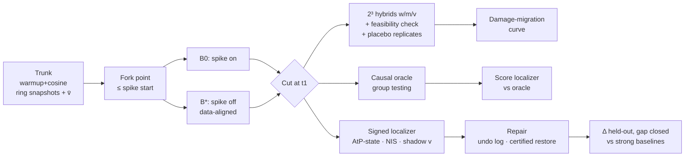

<div align="center">

# Optimizer Autopsy

**The afterlife of a loss spike: system identification of how Adam's memory writes lasting damage, and how to undo
it.**

A causal autopsy of Adam's optimizer state at the moment an LLM's training loss spikes. Bit-identical
counterfactual replay is the standard of proof. The instrument is built and was GPU-verified on CUDA. The science
runs on an AMD MI300X under [PLAN&nbsp;V8](PLAN_V8.md).

[](https://github.com/jaztulsi/optimizer-autopsy/actions/workflows/ci.yml)
[](LICENSE)
[](research/requirements.txt)
[](#program-and-compute)
[](#the-determinism-gate)

[Website](https://jaztulsi.github.io/optimizer-autopsy/) ·
[Question](#the-question) ·
[Method](#method) ·
[What's new](#whats-new-and-whats-not) ·
[Gate](#the-determinism-gate) ·
[Program](#program-and-compute) ·
[Status](#status) ·
[Layout](#repository-layout) ·
[Docs](#docs)

</div>

---

When a large model's loss suddenly jumps, today's fixes are blunt: clip the gradient, skip the batch, reset the
optimizer, or roll back and hope. All of them treat the optimizer as a black box. Nobody knows **how much of a
spike's lasting damage is carried by the weights and how much by Adam's moments `m` and `v`, or for how long**.
Optimizer Autopsy measures that split with a causal experiment. It then localizes the carrying coordinates and
repairs only those, and every claim is checked against a byte-for-byte identical replay.

## The question

**Headline (to be tested):** most of a loss spike's lasting damage may be written *after* the spike step, by Adam's
memory of it.
- **The echo:** on a large spike-dominated coordinate, the momentum echo writes a fraction β1/√β2 ≈ 92% of the total
  drift. This follows from Patitucci & Mokhtari's 2026 single-spike analysis.
- **The stall:** the inflated v also *stalls* ordinary learning for tens of steps.
- **The sharp prediction:** that same inflated v is *protective*, because it keeps the echo bounded. So cleaning v
  alone should make things worse than doing nothing. This is an out-of-sample test, on spikes, of the
  "history-coverage" account in a concurrent ICLR 2027 submission.

We measure this as one would identify a physical system:
- a **damage-writing kernel** (how much lasting damage the memory writes at each lag after the spike);
- a **refractory period** (how a spike blunts the effect of what comes next);
- **spike interference** (two spikes of the same vs opposite sign).

If the memory-written share is small, clipping or skipping at the spike step is enough, and that is worth knowing
too.

1. **Where does the damage live?** We fork a spiked run (B0) and its data-aligned clean twin (B\*) from the same
   snapshot. At a cut time after the spike, we build all 2³ cross-world hybrids `(w, m, v) ∈ {B0, B*}³` and train
   each to the end of the schedule. Their held-out losses decompose the lasting damage into weight-, m- and
   v-carried shares. Repeating this at several cut times gives a **damage-migration curve**: how fast damage moves
   from optimizer state into the weights.
2. **Which coordinates carry it?**
   - A causal group-testing oracle finds the minimal state support whose repair recovers the run.
   - Cheap signed predictors try to match it without forks: attribution patching over `(m, v)`, two-sided innovation
     tests, and a jump-robust "shadow v".
3. **Can we undo it, surgically?**
   - A **state-only retroactive deletion** (the undo log) removes the spike window's direct contribution from `m`
     and `v` and leaves the weights alone.
   - A **stability-certified restoration** makes the smallest move of `v` on the localized support that brings the
     preconditioned sharpness back under 2/η.
   - Both are compared with a strong baseline set on held-out loss.

If optimizer state turns out to carry almost nothing beyond a few dozen steps, that is a result too: "spike damage
is weight-carried after k steps".

## Method



Every branch (ours and every baseline) forks from the same snapshot, so two trajectories differ only by the edit
under test. Predictions are pre-registered before any AMD data exists ([PLAN V8 §7](PLAN_V8.md)). Several come in
closed form:
- a spike-dominated coordinate's total drift *saturates* at ≈ 5.84·η (β = 0.9/0.95) as the spike grows, so
  clipping a large spike barely changes its damage;
- honest Adam states satisfy |m| ≤ 1.165·√v (a known invariant; we use it as a hybrid-feasibility check);
- a planted v-poison of κ = 10⁴ halves its stall after ≈ 158 steps.

## What's new, and what's not

An adversarial fact-check found that **every component has precedent**. Only the SpikeState dataset is rated NEW,
and that verdict is low-confidence. What is new is the *study*: the first time-resolved causal (w, m, v)
decomposition of LLM loss-spike damage, with a bitwise counterfactual instrument and pre-registered predictions.
Localizers are scored against a causal oracle, and repairs must beat the strongest baselines. See
[PLAN V8 §5](PLAN_V8.md) and [`master-research/output/12_*`](master-research/output/).

| Ours (the study's claims) | Precedent we build on and cite |
|---|---|
| Time-resolved w/m/v damage shares for LLM spikes, β1×β2-identified | State transplants (Xu 2026; Chimera 2026; Guo 2026); "state washes out" (Ibrahim 2024) |
| Dose–response of spike-poisoned (m, v) on clean weights | m alone carries a trait (Xu 2026); moment transplants and history coverage, 34M–7B ("Newer Is Not Always Better", ICLR 2027 submission) |
| Lasting-damage mediation, as opposed to immediate control | Spike-onset capture and replay; selective tail-entrant limiting at 355M ("Understanding and Mitigating AdamW Loss Spikes", ICLR 2027 submission) |
| Localization inside stored m/v scored against a causal group-testing oracle | SPAM's g²/v test; AtP\*; ACDC; per-layer reset oracles |
| Post-spike stability-certified restoration of v, with both poison signs | Selective-v clearing, toy task (Biswas 2026); v edits at init (GI-Adam) |
| Window deletion from Adam's moments as a mediation probe and repair | One-step Adam inversion (SWIFT, TPDS 2024); memory-only deletion for L-BFGS (Stewart 2026) |
| Direct fault injection into m/v; repair instead of rollback | Gradient SDC drives v→∞ (Altenbernd 2026); per-layer restore (LayerCheck 2026) |
| Pre-registered held-out-rung prediction of damage shares | Small-scale proxies (Wortsman 2023); μP/CompleteP |
| **SpikeState** (NEW, low confidence) | Pythia / OPEN-1B released states (no spike curation) |

The spike mechanism (Bai et al., ICML 2026), bitwise replay (Megatron, OPEN-1B) and forking from released Pythia
states are cited, never claimed.

## The determinism gate

Replaying from a snapshot must produce identical numbers, or a fork's Δ measures nondeterminism instead of the
intervention.
- **CUDA:** the gate is built and verified (T4 proxy; P100 124M): `max|Δ| = 0` noop-vs-noop.
- **AMD:** it must be re-earned. On ROCm, `use_deterministic_algorithms` doesn't reach hipBLASLt, and torch 2.10's
  AOTriton attention backward ignores the deterministic flag.
- **The AMD day-1 gate** runs **across processes, through a spike window**. It uses a pinned
  `rocm/pytorch` torch 2.10.0 image, ROCm env vars set in the launcher, and math-backend attention for HVPs. If it
  can't reach zero, the pre-registered tolerance in [`docs/reference/PLAN_V7.md`](docs/reference/PLAN_V7.md) §4.4
  applies.

## Program and compute

| Tier | What | MI300X-h (estimates until `step_timer`) | Paper |
|---|---|---|---|
| T0 | AMD bring-up, determinism gate, `step_timer` | 3–5 | all |
| T1 | Minimal viable experiment: damage migration on 12 proxy instances | 1–2 | go/no-go |
| T2 | Full proxy + mid rung + 124M (n = 5, matched tokens/step) + Pythia-160M borrowed trunk + strong baselines | 50–80 | **P1 · ICML 2027** |
| T3 | Pythia ladder to 2.8B, μP collapse, held-out-rung prediction, OPEN-1B released states (use depends on its skip protocol), SDC, other optimizers | 200–450 | **P2 · NeurIPS 2027**, **P3 · SpikeState (datasets track)** |
| T4 | Own instrumented 1B trunks on an 8× node; Pythia-6.9B on one 192 GB card; RL fine-tuning / ViT | 500–2,000 | follow-ups |

A single MI300X (192 GB) holds fp32 weights, gradients, m and v for models up to about 7B. That lets forks stay
single-GPU, which avoids multi-GPU reduction-order nondeterminism. Venue dates are unofficial until the CFPs are
out.

## Status

```
Instrument (C1)      ####################  built; CUDA-verified Δ==0; AMD gate pending
Baselines            ################----  SPAM · ZClip · AdaGC · skip-step · v-reset · v̄ (PR #14); Adam-MR, StableAdamW… to add
Spike pipeline       ##############------  capture · natural · K2 manifest · new recipes; written, not yet pushed or run
Research + plan      ####################  PLAN V8, ~140-idea portfolio, two fact-check passes
Instrument fixes     ####----------------  held-out Δ, Bs clip, lr_bump schedule, disjoint eval (PLAN V8 §9.3)
Damage migration     --------------------  T1 MVE is the first science run on AMD
Localizer / repair   --------------------  unbuilt (C2 / C3); output contract defined (PLAN V8 §6.4)
```

## Repository layout

```
optimizer-autopsy/
├── PLAN_V8.md                Governing plan (read §0–§1 first)
├── CLAUDE.md                 Guardrails + harness interfaces (binding for every session)
├── index.html, styles.css    GitHub Pages site
├── docs/                     Doc map, improvement audit, reference/ (V7, V6, BUILD_PLAN, context-ai), archive/
├── master-research/          Research run: output/ (02–12), references.bib (verified only), RUN_LOG, merged skill
├── research/                 All source (Python)
│   ├── harness/              Determinism, preflight, secrets, (w,m,v) snapshots, trunk + fork runners, battery
│   ├── model/                nanoGPT: proxy (11M) and 124M
│   ├── data/                 Reproducible tokenize + shard
│   ├── spikes/               Spike recipes, detector, capture driver, natural-spike search, K2 manifest
│   ├── baselines/            skip · clip · resets · v̄ · SPAM · ZClip · AdaGC · skip-step
│   ├── localizer/ repair/    C2 / C3 (unbuilt; see PLAN V8 §6.4–6.5)
│   ├── analysis/             Attribution gate; eval + stats (to fill)
│   ├── theory/               Closed-form predictions (to fill)
│   ├── experiments/          proxy/ and llm124m/ configs + drivers
│   ├── kaggle/               Legacy CUDA run scripts (Kaggle paused) + step_timer
│   └── tests/                CPU tests (run in GitHub CI)
├── results/                  Committed run evidence (CUDA era)
└── notebooks/                Legacy Kaggle / Colab launchers
```

Large artifacts (checkpoints, snapshots, shards, spike sets) stay outside git, on the Hugging Face Hub.

## Docs

Start with [`PLAN_V8.md`](PLAN_V8.md), then [`docs/README.md`](docs/README.md) for the map. The research evidence
lives in [`master-research/output/`](master-research/output/). Citations are in
[`master-research/references.bib`](master-research/references.bib), which holds verified entries only.

## Running

Nothing runs on personal machines. The tests run in **GitHub CI** on every push and PR (CPU, no secrets, no GPU):
determinism, secrets, baselines, kill-test logic and the spike pipeline. GPU work runs only on the AMD MI300X, in
this order on day 1 ([PLAN V8 §8](PLAN_V8.md)):

```bash
pip install -r research/requirements.txt         # torch==2.10.0 (ROCm build from the pinned image)
python -m research.kaggle.step_timer             # measured speeds replace every estimate
python -m research.spikes.capture --selfcheck    # first real exercise of the capture driver
```

Secrets are never committed. `research/harness/secrets.py` resolves `HF_TOKEN` / `WANDB_API_KEY` at runtime, and a
CI test fails the build if a token literal reaches the tree.

## Contributing

Work through PRs, under your own identity. CI (ruff, sloppylint, tests, gitleaks) must be green. Don't modify
`research/harness/determinism.py` or `preflight.py` without flagging it first. See [`CLAUDE.md`](CLAUDE.md) and
[`CONTRIBUTORS.md`](CONTRIBUTORS.md).

## License

MIT. See [LICENSE](LICENSE).
