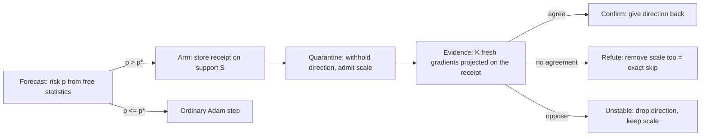

# RML-2: forecast-armed probation for loss spikes in Adam

Written 2026-11-10. Companion to `gap_ledger.md`. Nothing here has been run. Every number is a hand derivation
unless it carries a citation. Labels: **[est]** established in a cited source, **[der]** derived here (by the chair
or by the council, checked by at least one independent reviewer), **[spec]** speculative.

**Update 2026-11-12:** three proposed additions to the core method (per-example Appeal, the remedy tournament, the
repair ceiling) are in `rml3_method.md`; the survey behind them is `technique_map.md`. This file is unchanged by them.

## 0. Verdict first
- Five blind reviewers scored the surviving design **solid** (four) or **incremental** (one). None called it
  groundbreaking. All five named the same reason: there is no measured regime yet where a spike leaves damage above
  the noise floor. The reviewers were Claude models given different briefs, not independent experts, so their
  agreement is not verification.
- What moved during the run: the repair became simpler and its claims smaller. The theory became sharper, and it
  made six predictions before the prereg-v2 results were opened. Scored afterwards (§6.1a): two held, one failed,
  two were mixed and one could not be scored.
- Three prior-art searches found no paper that kills a claim. Several claims were narrowed to "known mathematics,
  new use" (§5). The searches read abstracts and snippets, so "not found" is weak evidence.

## 1. The method in brief
RML today undoes a spike's contribution to m and v three steps late, using a clean-batch twin that real training
does not have. RML-2 changes three things.

1. **Decide late, undo exactly.** A suspicious gradient is admitted on probation. Its direction (what would enter m)
   is withheld on the affected coordinates; its scale (what enters v) is admitted. The receipt needs no clean batch.
2. **Let the next batches judge.** If fresh gradients agree with the withheld direction, it was a real change and is
   given back. If they do not, it was an outlier, and its share of v is removed as well. The final state is exactly
   a mix of two states Adam could really be in: the run that skipped the gradient and the run that kept it,
   weighted by the confirmed fraction φ.
3. **Arm by forecast.** A tiny model scores each step's risk from free optimizer statistics. Because a false alarm
   costs only a short delay, the arming threshold can be low, and it is derived in loss units (§2.6).

A diagnostic comes with it: a two-term damage law (§2.4) that says how much a spike can cost and when the answer is
"nothing worth repairing".



## 2. Theory
Notation: m_t = β1 m_{t−1} + ε1 g_t, v_t = β2 v_{t−1} + ε2 g_t², ε1 = 1−β1, ε2 = 1−β2, update η m/√v,
r = β1/√β2, D = ε1/(√ε2 (1−r)) (5.84 at (0.9, 0.95); 31.8 at (0.9, 0.999)). A spike G at step s on a coordinate with
usual second moment v̄ has size z = |G|/√v̄ and dominance x = ε2 z².

### 2.1 Skip identity [der; trivial, see §5]
Let e_m = ε1(g_s − m_{s−1}) and e_v = ε2(g_s² − v_{s−1}). Then m_{s+k} − β1^k e_m and v_{s+k} − β2^k e_v are the moments
of a run that left m and v unchanged at step s and saw the same later gradients.
Conditions (first-principles reviewer): it is open loop (a real skip run sees slightly different later gradients);
Adam's step counter is one ahead of a true skip; in fp32 the subtraction from an inflated v loses about
log2(v/v̄) bits, so do it in fp64 as `autopsy/undo.py` already does. Consequence: with an honest receipt, RML's state
edit **is** skip-step applied with hindsight. It cannot beat skip on the state side. Its value is that the decision
can wait.

### 2.2 Echo and the two-channel law [der]
If a fraction a of the spike's innovation stays in m and a fraction b in v, the mean total displacement is

  E(a, b) = η · a · ε1 z Σ_k β1^k / √(1 + b·x·β2^k)  ≤  η · a · min(z, D/√b).

With a = b = 1 this is Ψ(z) ≤ min(z, D): 1.88 at z = 2, about 4.0 at z = D, 4.9 at z = 10, 5.84 in the limit (hand
sums). Reading existing fixes off the (a, b) plane:

| Fix | Where it lands | Echo left |
|---|---|---|
| nothing | (1, 1) | Ψ(z) |
| skip-step, RML-full | (0, 0) | 0 |
| gradient clipping by c (global, ZClip, AdaGC, SPAM's clip) | (c, c²) | Ψ(cz), the echo of a spike of size cz: 68% of the limit at cz = D, 84% at cz = 10 |
| SPAM clip at θ = 5000 | z → min(z, 71) | ≥ 99% of D (prediction) |
| undo v only | (1, 0) | z: unbounded, worse than nothing |
| undo m only, REBUILD_M | (0, 1) | 0, but the stall of §2.3 stays |
| update-size rules (StableAdamW, \|m/√v\| > 1) | act on the output | the echo's ratio is 0.447·r^k < 1, so they see only the spike step: ≤ 8% removed |

States with b ≥ a² satisfy the honest bound |m| ≤ 1.165√v (Cauchy–Schwarz; the bound itself is [est], Patitucci
and Mokhtari 2026, Remark 3.1). The clipping curve b = a² is that boundary. Probation moves off it, to (0, 1), and
ends at (φ, φ), a mix of the skip and keep states, which stays inside the honest region.

### 2.3 Stall law [der; found independently by the chair and by the first-principles reviewer]
While v is inflated, the coordinate takes shorter steps. The progress lost, in steps, is

  N_lost(x) = (2/ε2) · ln((1 + √(1+x)) / 2).

It is the continuous limit of Σ_k (1 − 1/√(1 + xβ2^k)), valid for small ε2 and a steady v̄.
At β2 = 0.95: 2 steps at z = 2, 22 at z = 10, 54 at z = 30. At β2 = 0.999: 376 at x = 1, 1,540 at x = 10, 3,420 at
x = 100. The qualitative stall is [est] (Kim 2026; Kalra and Barkeshli 2024 at initialisation); the closed form
was not found in what was read.

### 2.4 Two-term damage law [der, model]
At the end of training the cost of a spike on support S is, to second order,

  Δ ≈ ρ_S · N̄_lost · |dL/dt|_end   +   Q,   0 ≤ Q ≤ δᵀPδ / (4e·S_rem).

- **Stall term** (first order, does not heal): ρ_S is the share of progress carried by S, |dL/dt|_end the slope of
  the reference loss curve at the end.
- **Echo term** Q (second order, heals): δ is the echo displacement, P = diag(√v̄), S_rem the learning rate summed
  over the remaining steps as S actually receives it (Σ η_t √(v̄/v_t)). The bound needs a locally convex quadratic,
  a frozen preconditioner and at least about 100 steps; with momentum the constant changes slightly. Exactly,
  Q(S) = ½∫λ e^{−2λS} dE(λ), the Laplace transform of the curvature the spike excited. The inequality is textbook
  algebra (max over λ of λe^{−2λS}); the use is ours.
- The echo's first-order term has zero mean for an outlier and flips sign with the spike. Planting +G and −G and
  averaging isolates Q; the half-difference isolates the direction effect.
- Chaos is outside the law. It is the floor the prereg already measures.

This is why the pilot saw almost nothing at (0.9, 0.95): N_lost is 2 steps at realistic size, and Q heals.

### 2.5 Why the repair is a corner, and the sign test [der]
Mid-training Q ≈ 0, so the cost is nearly linear in the edit and the optimum sits at a corner (first-principles
review). For an outlier the corner is the skip state: m out (no echo), v out (no stall). For a real, persistent
change it is "keep". The only quantity to estimate is the persistence fraction φ of the spike:

  φ̂ = ⟨ḡ_fresh − m, G − m⟩ / ⟨G − m, G − m⟩   (m and v are the pre-spike values on S, the weights are 1/v, and
  ḡ_fresh is the mean of K later gradients).

This regresses fresh innovations on the flagged one; centring on m removes the bias from ordinary drift. Under an
outlier the normalised statistic is standard normal; under a persistent shift of the same size its mean is
‖z_S‖ per step, at least 5.8 for one saturated coordinate. So one to three steps suffice, and a sequential test
can stop early. The final state is the mix (1 − φ̂)·(skip state) + φ̂·(keep state):
m gets φ̂·β1^k·e_m back and v loses (1 − φ̂)·β2^k·e_v. Both corners are exact (φ̂ = 0 is the skip identity, φ̂ = 1 is the
untouched run), and a mix of two honest states is honest because the square root is concave.
A strongly negative statistic means the fresh gradients oppose the spike (oscillation): drop the direction, keep
the scale. **Never worse than skip** holds in this sense: if φ̂ is replaced by its lower confidence bound, the
re-admitted part is, with the chosen probability, a true descent component.

The council cut three parts of the chair's first design as optimising the wrong objective (short-run loss on stiff
modes that heal anyway): the line search to s* = β0/κ, the "mirror event" weight return, and the proximal anchor.
They remain in `master-research/raw/novelty-2026-11/council/` as untested extensions for late, unarmed detections.

### 2.6 Forecast: a threshold in loss units, and a free stability thermometer [der]
- **Arming rule.** A false alarm delays a real gradient's direction by K steps: cost about (1−β1^K) of one step's
  progress on S (0.27 at K = 3). A miss costs N_lost(x) steps plus Q. A hit still pays the stall during
  probation, N_K(x) = Σ_{k<K} (1 − 1/√(1 + xβ2^k)) ≤ K. Arm when the predicted probability of an outlier exceeds
  p* = 0.27 / (0.27 + N_lost(x) − N_K(x)): about 14% at z = 2 and 1.3% at z = 10 for β2 = 0.95. The predictor
  can be crude because the action is reversible.
- **Thermometer.** With a frozen preconditioner, a mode of preconditioned curvature a = ηλ̃ taken alone and driven by white gradient noise, follows an AR(2) process
  with lag-1 autocorrelation ρ1 = 1 − 2a/a_max, a_max = 2(1+β1)/(1−β1) = 38. So gradient autocorrelation estimates the
  distance to the edge of stability with no Hessian products (diluted by gradient noise away from the edge; the
  threshold a_max is [est], Cohen et al. 2022; negative consecutive-gradient correlation as a warning sign is old).
- **Features** (all free reductions): innovation dominance x per tensor, RMS(g²/v) (Wortsman et al. 2023 report it
  precedes spikes by 1 to 8 steps [est]), share of coordinates with |m/√v| > 1 (170× higher at spike onset per the
  abstract of OpenReview pAjrfibDB9), cos(g_t, m_{t−1}), gradient-norm and loss z-scores, ρ̂1, the learning rate.
  Model: logistic regression or a small tree ensemble on these, trained on the harness's exact forks.
- **Limits.** A pure data outlier cannot be forecast from the state; there the arming signal is the innovation size
  at the step itself. Optional typing at lag zero: score the suspicious batch with a frozen small reference model;
  high loss under both models points to the data, high loss only under the live model to the state (the logic of
  RHO-LOSS, applied to spikes).

## 3. Algorithm
```
each step s, in the pre-optimizer hook (sees clipped g and pre-update m, v):
  features -> risk p ;  x_i = ε2 (g_i − m_i)² / v_i
  if p > p*(x):                         # arm
      S = {i : x_i ≥ x_arm} (or the whole step when the step-level score is high)
      store receipt R = (s, S, g_S, m_S, v_S)
      feed the optimizer g := m on S     # direction withheld
      after opt.step(): v_S += ε2 (g_S² − m_S²)          # scale admitted
  for each open receipt R of age k:
      y_k = Σ_S (g_i − R.m_i)·(R.g_i − R.m_i) / R.v_i ; update the sequential test
      if decided, or k = K:
          φ = clip(lower bound of φ̂, 0, 1)   (φ = 0 if the test opposes)
          m_S += φ · β1^k ε1 (R.g − R.m)             # confirmed share of the direction
          v_S −= (1 − φ) · β2^k ε2 (R.g² − R.v)       # unconfirmed share of the scale (kept if the test opposes)
          close R
```
- Cost: ordinary steps pay one elementwise compare and a few reductions. An open receipt holds three sparse
  vectors on S and costs one inner product per step. No extra forward or backward pass.
- Determinism: a pure function of the gradient stream and the state. Arithmetic on S in fp64, parameters keyed by
  name, tied `wte` once. With nothing armed the run must be bitwise equal to a no-op.
- Hyperparameters: K (3), the test level (3 SE), x_arm (from the knee, x = ε2 D²). The forecast's weights are data.

## 4. What it should beat, and why (expected, not measured)
| Baseline | Its limit | RML-2's expected edge |
|---|---|---|
| skip-step (immediate, irreversible) | one threshold must trade missed outliers against discarded real changes | decides after K batches; on outliers it matches skip after paying at most K steps of stall on S; keeps real changes |
| rollback-and-skip | exact, but needs a snapshot, replays L+1 steps, shifts the data stream, discards real changes | no snapshot, no replay, no shift |
| clipping family, SPAM clip | echo-neutral above the knee (§2.2) | removes the echo and the stall |
| SPAM / Adam-MR resets | by the clock; wipe all history | touches only S, only when armed |
| REBUILD_M, undo-m | stall stays | removes v's share with m's |
| update-size limiters | blind to an outlier's echo | complementary: they act on instability onset |
| RML (twin receipt, lag 3) | needs a clean twin; open loop; cannot tell a real change | no twin; evidence from the stream |

It does **not** beat oracle skip on a plain bad batch: it trails by the stall paid during probation, at most K
steps on S. The edge is in the mixed case (outliers and real
changes at the same threshold), at long v memory, and wherever the forecast arms early.

## 5. Novelty check
| Claim | Nearest prior work | Verdict of the search |
|---|---|---|
| Skip identity as a receipt | Maclaurin et al. 2015, reversible learning [1502.03492](https://arxiv.org/abs/1502.03492); Swift [2302.06173](https://arxiv.org/abs/2302.06173) (exact inverse of the last Adam step); unlearning targets [2508.12220](https://arxiv.org/abs/2508.12220) | mathematics known; the use for delayed spike decisions not found |
| Decide a past gradient's weight from later gradients | Learning to Reweight [1803.09050](https://arxiv.org/abs/1803.09050) (clean set, 3× cost, same step); Cautious [2411.16085](https://arxiv.org/abs/2411.16085) (masks the step, never edits m); Bengio et al. 2021 [2106.03955](https://arxiv.org/abs/2106.03955) (corrects stale momentum for drift); TAdam, AdaTerm, WoLF (weights fixed at arrival) | not found |
| Two-channel law, clipping echo-neutral | ADOPT-clip [2411.02853](https://arxiv.org/abs/2411.02853), TAdam [2003.00179](https://arxiv.org/abs/2003.00179), ACClip [1912.03194](https://arxiv.org/abs/1912.03194) limit m only, without this argument | not found |
| Cumulative echo, knee | MVN-Grad [2602.10204](https://arxiv.org/abs/2602.10204) (per-update bound) | not found; a reviewer may call it a corollary |
| Stall closed form; two-term law | Kim 2026 [2608.15824](https://arxiv.org/abs/2608.15824); butterfly-effect studies (Altıntaş et al. 2025 [2506.13234](https://arxiv.org/abs/2506.13234)) are empirical | the bound is textbook; the application not found |
| Spike forecasting | **Kim S. 2026, *Transport Instability Coordinates*, ICML workshop ([link](https://icml.cc/virtual/2026/80057))**: a hazard model on AdamW state that forecasts spikes; Huang et al. 2026 monitors; Bai et al. 2026 | **forecasting itself is taken.** Left: free features, a reversible action, a threshold in loss units |
| ρ1 = 1 − 2a/a_max | GradaGrad [2206.06900](https://arxiv.org/abs/2206.06900); Cohen et al. 2022 [2207.14484](https://arxiv.org/abs/2207.14484) | formula not found; the sign heuristic is old |
| Reference-model typing | RHO-LOSS [2206.07137](https://arxiv.org/abs/2206.07137); PaLM replay | logic known; spike typing not found |

Background cited from memory and not re-read: sequential tests (the SPRT of Wald, CUSUM) and slow-weight methods
such as Lookahead. Two different authors named Kim appear above: *Second-Moment Memory in Coordinatewise Adam*
(2608.15824) and *Transport Instability Coordinates* (Kim Sanghyun, workshop).

Already inside the project and not claimed as new: the state-only undo log, quarantine with deferred commit, GLR and
persistence routing, a learned hazard probe (catalogue item A15, rated low), a lower-tail detector for lead time.
The response-operator analysis of Liu and Li 2026 ([2608.19762](https://arxiv.org/abs/2608.19762)) is the paper
most likely to contain the receipt algebra as a lemma; its full text must be read before any claim is written up.

## 6. Predictions and experiments
### 6.1 Blind predictions for the prereg-v2 run
These were written before `results/mi300x_2026-11-10/` was opened; the scores are in §6.1a. The prereg's own arms separate the two terms of §2.4:
stall = Δ(undo-m) − Δ(undo-m+v), echo = Δ(none) − Δ(undo-m).
| # | Prediction (phases 1000 and 1800, doses with d(B0) ≥ 2) | Refuted if |
|---|---|---|
| B1 | Damage is sub-linear in dose: slope of log Δ(none) against log c between c = 10 and c = 30 is below 0.8 | slope ≥ 1 |
| B2 | The stall term grows like log dose: stall(c=30)/stall(c=10) between 1.5 and 2.5 | ratio > 4 or < 1 |
| B3 | The echo term saturates: echo(c=30)/echo(c=10) between 1 and 1.5 | ratio > 2.5 |
| B4 | Undoing v alone gets worse with dose: Δ(undo-v)/Δ(none) increases in c and is ≥ 3 at c = 30 | not increasing |
| B5 | Stall is about N̄_lost(c) · \|dL/dt\|_end, within a factor of 2 | off by more than 4× |
| B6 | Later spikes keep more echo: echo(1800) > echo(1000); stall(1800) ≈ stall(1000) | echo(1800) < echo(1000) by more than 2σ |
If every cell is inside the floor, none of these can be scored. That outcome is itself what §2.4 predicts at
(0.9, 0.95) and realistic size.

### 6.1a Scores (2026-11-10)
Opened after the go-ahead, from `results/mi300x_2026-11-10/2026-11-10_prereg_v2/report_final/sealed.json`
(tag `prereg-v2`, seed 0, one run per cell). End-of-run damage in nats:

| Phase | c | none | undo-m | undo-v | undo-m+v |
|---|---|---|---|---|---|
| 1000 | 1 | −0.0001 | 0.0050 | −0.0004 | 0.0026 |
| 1000 | 3 | 0.0043 | 0.0047 | 0.0035 | 0.0017 |
| 1000 | 10 | 0.0114 | 0.0037 | 0.0255 | 0.0018 |
| 1000 | 30 | 0.0154 | 0.0141 | 0.2030 | 0.0011 |
| 1800 | 1 | 0.0024 | 0.0023 | 0.0040 | 0.0020 |
| 1800 | 3 | 0.0059 | 0.0007 | 0.0075 | 0.0000 |
| 1800 | 10 | 0.0110 | 0.0059 | 0.0451 | −0.0003 |
| 1800 | 30 | 0.0244 | 0.0114 | 0.5719 | −0.0006 |

| # | Result | Score |
|---|---|---|
| B1 | slope between c = 10 and 30: 0.28 (phase 1000), 0.72 (phase 1800) | **held**. Outside its scope, phase 160 gives 1.06 |
| B2 | stall ratio 6.8 (phase 1000), 1.95 (phase 1800) | **mixed**: refuted at 1000, held at 1800 |
| B3 | echo ratio 0.17 (phase 1000), 2.54 (phase 1800) | **failed**: outside the predicted 1 to 1.5 in both phases. The registered refutation line (> 2.5) is crossed only at 1800, and barely. It had no lower bound, so the 0.17 is the worse miss and the line did not catch it |
| B4 | undo-v against none at c = 30: 13× (phase 1000), 23× (phase 1800); rising from c = 3 up | **held**, with one dip from c = 1 to c = 3 at phase 1800 (1.63 to 1.28) |
| B5 | needs the per-coordinate spread of x (the report stores only its mean per dose), the share ρ_S and the end slope of the reference loss. The raw run logs were not searched | **not scored** |
| B6 | echo larger at 1800 for c = 3 and 30, smaller for c = 10; stall equal at c = 30, 3× apart at c = 10 | **mixed** |

Reading:
- The two statements about totals held. Damage is sub-linear in dose, and removing the spike from v alone is far
  worse than doing nothing. A 3× dose step multiplied undo-v damage by 8.0 and 12.7 (about the square of the dose,
  as the unbounded echo in §2.2 says) while "none" grew by 1.35 and 2.2.
- The split of the damage into an echo part and a stall part did **not** hold. §2.4's additive two-term form is
  unsupported by this run. Two likely reasons, neither tested: the terms interact (v's inflation damps the echo),
  and one run per cell carries a sign-indefinite scatter of about ±0.003 to 0.005 nats, visible at c = 1 in phase
  1000 (none −0.0001, undo-m +0.0050, undo-m+v +0.0026). The 1-ulp floor there is about 4e-7, so it does not
  measure this scatter.
- The direct write (undo-m+v at lag 0) is flat in dose: 0.0026, 0.0017, 0.0018, 0.0011 at phase 1000. That is what a
  saturated first update (0.447η per coordinate whatever the size) predicts, but it was not a registered prediction.
- At c = 1 the damage is 0.0004, −0.0001 and 0.0024 nats in the three phases, all below the prereg's 0.01-nat
  practical size.
- "Held" means not refuted on one seed. Every cell is one run.

**Repair arms at c = 1** (same file, `_repair`; end-of-run damage in nats, lower is better):

| Arm | Phase 160 | Phase 1000 | Phase 1800 |
|---|---|---|---|
| none | 0.0005 | −0.0001 | 0.0024 |
| skip-step, oracle timing | −0.0013 | 0.0031 | −0.0002 |
| skip-step, detector timing | 0.0018 | 0.0029 | 0.0050 |
| rollback | 0.0038 | −0.0000 | 0.0065 |
| rollback k | 0.0132 | 0.0086 | 0.0105 |
| ZClip | −0.0026 | −0.0001 | 0.0024 |
| AdaGC | 0.0136 | 0.0066 | 0.0127 |
| SPAM | 0.0799 | 0.0488 | 0.0060 |
| v reset | 0.0740 | 0.0529 | 1.5975 |
| RML at lag 3 | −0.0002 | 0.0023 | 0.0008 |
| RML with cooldown | −0.0020 | 0.0020 | 0.0019 |
| RML selective | −0.0009 | 0.0017 | 0.0009 |

- There is nothing to repair at this dose, so no arm can show a gain, RML included. The "closes" shares in the
  report divide by a damage near zero and should not be quoted.
- The arms that touch v without a receipt do harm: SPAM and v reset cost 0.05 to 0.08 nats at phases 160 and 1000,
  and v reset costs 1.6 nats at phase 1800. This supports the rule in §2.2 (never lower v without the matching cut
  in m). It is evidence for a safety rule, not for a repair.
- ZClip equals "none" to five decimals at phases 1000 and 1800. It probably never fired (inference, not checked).
- The global cooldown arm was worse than doing nothing at c ≥ 10 in all three phases (for example 0.056 against
  0.015 at phase 1000, c = 30). A forecast that answers with a learning-rate cut would pay this cost on every alarm.

**What this means for RML-2.** The proxy at (0.9, 0.95) cannot test it: at realistic dose there is no damage, and
at high dose the full undo at lag 0 already removes almost all of it (0.0011 of 0.0154 left at phase 1000, c = 30).
The second fact supports the receipt idea (the damage sits in m and v, not in the first weight write), but it was
measured with the clean-batch receipt, not the twin-free one. The decomposition that sets the arming threshold p*
(§2.6) rests on the two-term law, which this run does not support, so p* is unvalidated.

### 6.2 New experiments (about 10 GPU-hours on the proxy; each needs a go-ahead and a timed fork first)
| # | Design | Success | Failure |
|---|---|---|---|
| X1 stall law, about 3 h | β2 = 0.999, dose set so x ∈ {1, 10, 100}; arms none, undo-m, undo-m+v, placebo; 8 data orders | Δ(none) ≥ 0.01 nats at x = 10 and stall(100)/stall(10) = 2.2 ± 0.6 | all cells within ±0.003: write the null result with the law as its bound |
| X2 probation against skip, about 3 h | mixed events: bad batches and planted persistent shifts; skip at 3, 5, 7σ, probation armed at 3σ, SPAM, ZClip, AdaGC, rollback | lower total regret than every skip threshold by > 0.003 nats; ≥ 80% of the adaptation skip loses is kept | some skip threshold ties on both |
| X3 forecast, about 2 h | runs at raised LR to provoke instability; fit the tiny model offline on logged features | at 1 false alert per 1,000 steps, ≥ 50% of onsets flagged ≥ 1 step ahead; AUC ≥ 0.8 and ≥ 0.05 above RMS(g²/v) alone; ρ̂1 margin correlates ≥ 0.7 with measured sharpness | AUC < 0.7 or no gain: drop the model, keep innovation-size arming |
| X4 echo checks, about 0.5 h | 60-step forks at z ∈ {2, 6, 10, 30}; clip, SPAM clip, StableAdamW, undo-v | displacement within ±20% of Ψ(z), and of Ψ(cz) under clipping; SPAM's clip leaves ≥ 90% at z ≥ 30 | any outside ±40% |

Where the budget allows, each cell also gets at least 3 model seeds besides the data orders, X2 reports regret
against the mix of outliers and shifts, and natural spikes (the K2 checkpoints) are the second test bed once X1
shows a regime.

## 7. Repo blueprint
Nothing below touches `harness/determinism.py` or `harness/preflight.py`, adds a dependency, or runs locally.
1. `research/repair/receipt.py`: the receipt and the two edits (remove, re-admit), in the style of `autopsy/undo.py`.
   CI test in fp64: skip identity to 1e-12; constants D, Ψ, N_lost.
2. `research/repair/probation.py`: `as_pre_opt_step(policy)`. Arming and quarantine use the existing hook pair (edit
   `p.grad` on S, return an `undo()` that fixes v after `opt.step()`); evidence and verdict run in the same hook.
3. `research/baselines/knee.py`: irreversible per-coordinate rejection at the knee, the simplest comparison arm.
4. `research/repair/forecast.py`: feature logging in `on_step`, and a pure scoring function with weights kept in
   `experiments/proxy/`.
5. `research/analysis/damage_law.py`: N_lost, Ψ, the ceiling, and the fits for §6.1.
6. `autopsy/mve.py`: new `Branch` entries in `repair_battery`. The support S with scores x is a `Localization` in
   the sense of PLAN_V8 §6.4, so the localizer stub gets its first real output for free.
7. Gates before any data counts: the null-repair identity (installed, never armed, bitwise equal to no-op) and
   `fork_determinism_gate` with the hooks inert.

## 8. Original plan and updated plan
| Item | Original (PLAN_V8, RML) | Updated |
|---|---|---|
| Headline question | how much damage is written through w, m, v | unchanged |
| Harness, chaos units, prereg discipline | as built | unchanged |
| C-1 mediation, C-3 interference | measured | unchanged |
| C-2 protective v | "undo-v alone is worse" | kept, now a formula (displacement z against Ψ(z)) with its price, the stall |
| C-4 repair | undo m and v at lag 3 with a clean-twin receipt; variants full, cool, sel | probation: twin-free receipt, decision from later gradients, shrink to the confirmed fraction; RML-full is its "refute" corner |
| Real changes, instability | not told apart | told apart by the sign of one statistic (instability branch untested) |
| Detector | z-scores, fixed lag as a constant | forecast with a threshold in loss units; lag removed for armed events |
| Theory | echo corollary, closed-loop band | two-channel law, stall law, two-term damage law, thermometer |
| "No lasting damage" | a risk | a predicted outcome with a stated bound |
| Experiments | prereg-v2 | prereg-v2 scored against blind predictions, then X1 to X4 |

**How much really changed.** An independent panel (`master-research/raw/novelty-2026-11/council/r3_panel.md`) put
the share of the plan's substance that is new or replaced at about 35%. The measurement backbone, roughly half of
the plan, is untouched. The theory change is real: the panel re-derived the formulas and they held. The repair
change is partly relabelling, because RML-full already equals skip with hindsight and a deferred-commit log was
already in the project. The experiments are new but unrun.

## 9. Council log
- **Round 1.** Three houses of 25 seats reported (theorists on Opus, engineers on Sonnet, skeptics on Haiku); the
  fourth (adjacent fields, on Fable) was cut off by the usage limit and did not finish. Theorists: 25 proposals, 2
  stand, 14 wounded, 9 killed. Engineers: 25 items and the regimes where repair can matter. Skeptics: 25
  objections, one rated fatal (the clean-twin receipt), which the skip identity answers.
- **Round 2.** Five blind reviewers ranked 11 anonymized candidates. Points (5 for first to 1 for fifth): damage law
  17, twin-free retroactive skip 15, the chair's probation protocol 10, knee rejection 8, regime program 8,
  swap test 6, ratio rule 6, echo regression 3, rare-row undo 1.
- **Agreed.** The damage law and the regime experiment come first; the skip identity is the operator.
- **Clashed.** Two reviewers wanted the full protocol as the method; three wanted it cut to the receipt plus a
  sign test. The cut version is §3.
- **Blind spots named.** Everything assumed damage exists; nobody priced the detector; the stall was missing from
  the damage account; all tests scored loss near the event, not at the end of training.
- **Corrections taken.** The chair's line search optimised the wrong objective; its weight-return constant was
  wrong while v decays; its v-lift was not dimensionless; a learning-rate cut to exactly the stability edge needs a
  margin.
- **Round 3.** A three-reviewer panel re-derived the stall law, the echo bound, the arming threshold and the
  thermometer (all held, with the conditions now stated) and found four errors in the first draft of §3: the
  verdict state, a refute that was not an exact skip, an uncentred statistic, and the stall missing from p*. All
  four are corrected in this version.
- **Loop.** After two rounds the answer to "groundbreaking or incremental?" stayed "solid". More ideation did not
  change it; a measured regime would.

## 10. Risks and open debts
1. No regime may exist at (0.9, 0.95). Then the contribution is the damage law and a negative result.
2. The forecast competes with existing early-warning work and with update limiters that already report zero
   spikes at 774M parameters (abstract only, OpenReview pAjrfibDB9).
3. Reading debts in `gap_ledger.md` §4, plus Liu and Li 2026 in full. One searcher could not retrieve arXiv
   2609.18314 that a reader had opened; re-check the id before citing.
4. Every derivation here assumes single, isolated events. Overlapping receipts, bf16 state and sharded optimizers
   are untreated.
