# 02 · Lineage: citation graph, 2025–2026 citers, missing roots

*Lineage role, Phase 2 of the master-research pass. Written 2026-10-22. No code was run; the only shell
command used was `date`.*
*Builds on `research/spikes/RESEARCH.md` §1, `improvement.md` §2.3–2.5 and the 16 rival JSONs in
`spike-related-work/results/`. Nothing here repeats their per-paper analysis. Where a paper is already
covered there, this file only places it in the graph.*

**Evidence labels**
- **V-ref:** the edge appears in the citing paper's Semantic Scholar (S2) reference list.
- **V-cit:** the citing paper appears in the cited paper's S2 citation list.
- **V-abs:** claim checked against the arXiv abstract, pulled via the arXiv API or the abs page.
- **V-html:** claim checked against the first ~100k characters of the arXiv HTML full text.
- **I:** inferred, i.e. reasoned from titles, abstracts or shared authors, not observed directly.
- **A:** assumed, from memory, not re-checked this session. Treat as **UNVERIFIED** until checked.

**Bottom line.**
1. **Core novelty still holds.** Across 9 anchors' forward citations (about 270 citing records) and keyword
   searches, no 2025–2026 paper localizes poisoned directions inside Adam's `m`/`v` **and** repairs only those
   directions **and** checks the repair with deterministic counterfactual forks. Scope of that claim: the
   surface searched here (§4), as of 2026-10-22.
2. **Sub-claims are now threatened.** Five 2026 papers own pieces we were going to describe as ours:
   - **optimizer-state transplant ("state surgery"):** Xu, 2608.20442;
   - **direction-level causal ablation with an energy-matched control:** Xie et al., 2608.02091;
   - **theory of when to reset optimizer state:** Topollai & Choromanska, 2603.16731;
   - **paired runs that share a future:** Liu & Li, 2608.19762 (already known); Guo, 2608.24593;
   - **corrupted gradient sends `v`→∞, with "momentum resets" listed as future work:** Altenbernd et al., 2604.00726.

---

## 1 · Citation graph

The graph has 3 backward strands, the forward 2025–2026 citers, and this project (`OA`, planned, dashed
edges). Arrows point from citing to cited. Edge labels: `cites`, `extends`, `contradicts`. The evidence label
for every edge is in the table in §1.1.

```mermaid
graph LR
  subgraph SA["Strand A - adaptive-optimizer instability"]
    ADAM["Kingma and Ba 2014 Adam<br/>1412.6980"]
    AMS["Reddi 2018 AMSGrad<br/>1904.09237"]
    ADAF["Shazeer and Stern 2018 Adafactor<br/>1804.04235"]
    RADAM["Liu 2019 RAdam<br/>1908.03265"]
    JAS18["Jastrzebski 2018 sharpest directions<br/>1807.05031"]
    GUR["Gur-Ari 2018 tiny subspace<br/>1812.04754"]
    SONG["Song 2024 not a tiny subspace<br/>2405.16002"]
    MA20["Ma Wu E 2020 Adam dynamics<br/>2009.06125"]
    CAT["Lewkowycz 2020 catapult<br/>2003.02218"]
    EOS["Cohen 2021 GD edge of stability<br/>2103.00065"]
    GIL["Gilmer 2021 curvature and instability<br/>2110.04369"]
    AEOS["Cohen 2022 adaptive EoS<br/>2207.14484"]
    SELF["Damian 2022 self-stabilization<br/>2209.15594"]
    CFLOW["Cohen 2024 central flows<br/>2410.24206"]
    LISP["Li 2023 Loss Spike in NNs<br/>2305.12133"]
    MOLY["Molybog 2023 Adam instability<br/>2304.09871"]
    STAB["Wortsman 2023 StableAdamW<br/>2304.13013"]
    PROX["Wortsman 2023 small-scale proxies<br/>2309.14322"]
    ZHAI["Zhai 2023 entropy collapse<br/>2303.06296"]
    PALM["PaLM 2022 rewind and skip<br/>2204.02311"]
    OPT["OPT 2022 restarts<br/>2205.01068"]
    TAK["Takase 2023 Spike No More<br/>2312.16903"]
    BAI["Bai 2025 ICML26 preconditioner spikes<br/>2506.04805"]
  end

  subgraph SB["Strand B - causal and counterfactual analysis of training"]
    KOH["Koh and Liang 2017 influence fns<br/>1703.04730"]
    HARA["Hara 2019 SGD-influence replay<br/>1906.08473"]
    TRACIN["Pruthi 2020 TracIn<br/>2002.08484"]
    DMOD["Ilyas 2022 datamodels<br/>2202.00622"]
    TRAK["Park 2023 TRAK<br/>2303.14186"]
    SOURCE["Bae 2024 unrolled diff SOURCE<br/>2405.12186"]
    MAGIC["Engstrom and Ilyas 2025 REPLAY and MAGIC<br/>2503.13751 2504.16430"]
    FRANK["Frankle 2020 instability analysis forks<br/>1912.05671"]
    VIG["Vig 2020 causal mediation<br/>2004.12265"]
    ROME["Meng 2022 causal tracing<br/>2202.05262"]
    PATCH["Zhang and Nanda 2023 / Heimersheim and Nanda 2024 patching<br/>2309.16042 2404.15255"]
    LIULI["Liu and Li 2026 AdamW ISO paired forks<br/>2608.19762"]
    GUO["Guo 2026 optimizer-state transport<br/>2608.24593"]
    XU["Xu 2026 optimizer-state surgery<br/>2608.20442"]
    UNL["2025 state-exact replay unlearning<br/>2508.12220"]
  end

  subgraph SC["Strand C - optimizer-state resets and repair"]
    RESTART["ODonoghue and Candes 2012 adaptive restart<br/>1204.3982"]
    NIK["Nikishin 2022 primacy bias resets<br/>2205.07802"]
    SOKAR["Sokar 2023 ReDo dormant neurons<br/>2302.12902"]
    LYLE["Lyle 2023 plasticity<br/>2303.01486"]
    LEWAN["Lewandowski 2023 curvature directions<br/>2312.00246"]
    FARIAS["Farias 2024 self-normalized resets<br/>2410.20098"]
    ASADI["Asadi 2023 reset optimizer RL<br/>2306.17833"]
    ELLIS["Ellis 2024 Adam-Rel<br/>2412.17113"]
    SPAM["Huang 2025 SPAM<br/>2501.06842"]
    SSPAM["GradientStabilizer ex Stable-SPAM<br/>2502.17055"]
    ZCLIP["Kumar 2025 ZClip<br/>2504.02507"]
    ADAGC["Wang 2025 AdaGC<br/>2502.11034"]
    TOPO["Topollai 2026 state staleness resets<br/>2603.16731"]
    SDC["Altenbernd 2026 silent data corruption<br/>2604.00726"]
  end

  subgraph SF["2025-2026 forward citers, threats and theory"]
    RAMA["Ramasinghe 2026 precond curvature tracking<br/>2606.16768"]
    TIAN["Tian and Paquette 2026 layer-wise spike sim<br/>2610.13524"]
    TANG["Tang 2026 Adam stability phase diagram<br/>2609.18314"]
    WNC["Li Zhou Xu 2026 weight-norm criticality<br/>2607.21005"]
    GLITCH["Liu 2026 Grokking or Glitching<br/>2605.06152"]
    MAO["Huang 2026 Mechanism-Aligned Observability<br/>2606.28116"]
    QKC["Xie 2026 One QK Channel causal probe<br/>2608.02091"]
    CAST["Li 2026 CAST spectral clipping<br/>2610.19761"]
    MSIGN["Ren 2026 MSign<br/>2602.01734"]
    GNMR["Kong 2026 GNMR<br/>2606.00539"]
    SLIM["Kalra 2025 SlimAdam v-SNR<br/>2503.01843"]
    ROAD["Lee 2026 The Road Taken<br/>2608.18415"]
    FONG["Fong 2026 Adam at EoS feedback<br/>2608.20638"]
    BSFA["Zhou 2025 BSFA subspace dichotomy<br/>2510.25244"]
  end

  OA(["OA - Optimizer Autopsy C1 C2 C3 planned"])

  %% Strand A internal
  AMS -->|contradicts| ADAM
  RADAM -->|extends| ADAM
  ADAF -->|extends| ADAM
  SONG -->|contradicts| GUR
  AEOS -->|extends| EOS
  CFLOW -->|extends| AEOS
  PROX -->|extends| STAB
  STAB -->|extends| ADAF
  BAI -->|cites| AEOS
  BAI -->|cites| EOS
  BAI -->|cites| CFLOW
  BAI -->|cites| MOLY
  BAI -->|extends| MA20
  BAI -->|extends| LISP
  BAI -->|cites| CAT
  BAI -->|cites| SELF
  BAI -->|cites| ZHAI
  BAI -->|cites| PALM
  BAI -->|cites| AMS
  BAI -->|cites| RADAM
  BAI -->|cites| JAS18
  BAI -->|cites| ADAM

  %% Strand C internal
  SPAM -->|cites| MOLY
  SPAM -->|cites| TAK
  SPAM -->|cites| PALM
  SPAM -->|cites| OPT
  SPAM -->|extends| RESTART
  SPAM -->|cites| EOS
  SPAM -->|cites| ADAF
  SPAM -->|cites| ZHAI
  SSPAM -->|extends| SPAM
  SSPAM -->|cites| ZCLIP
  SSPAM -->|cites| STAB
  ADAGC -->|cites| SPAM
  ADAGC -->|cites| ZCLIP
  ADAGC -->|cites| BAI
  ADAGC -->|cites| STAB
  ELLIS -->|extends| ASADI
  SOKAR -->|extends| NIK
  LEWAN -->|extends| LYLE
  FARIAS -->|extends| SOKAR
  TOPO -->|extends| SPAM
  TOPO -->|cites| ASADI
  SDC -->|cites| SPAM
  SDC -->|cites| MOLY

  %% Strand B internal
  TRACIN -->|extends| KOH
  HARA -->|extends| KOH
  TRAK -->|extends| DMOD
  SOURCE -->|extends| HARA
  MAGIC -->|extends| DMOD
  ROME -->|extends| VIG
  PATCH -->|extends| ROME
  LIULI -->|cites| BAI
  LIULI -->|cites| SPAM
  LIULI -->|cites| PROX

  %% Forward citers
  RAMA -->|cites| AEOS
  RAMA -->|cites| PROX
  RAMA -->|cites| STAB
  RAMA -->|cites| MOLY
  TIAN -->|cites| BAI
  TIAN -->|cites| AEOS
  TIAN -->|cites| PROX
  TIAN -->|cites| MOLY
  TANG -->|contradicts| BAI
  TANG -->|cites| AEOS
  WNC -->|contradicts| BAI
  WNC -->|cites| MOLY
  GLITCH -->|cites| BAI
  GLITCH -->|cites| AEOS
  GLITCH -->|cites| PROX
  MAO -->|cites| PROX
  QKC -->|cites| SPAM
  QKC -->|cites| ADAGC
  QKC -->|cites| MOLY
  CAST -->|cites| ZCLIP
  CAST -->|cites| ADAGC
  MSIGN -->|cites| ZCLIP
  MSIGN -->|cites| PROX
  GNMR -->|cites| SPAM
  SLIM -->|cites| AEOS
  ROAD -->|cites| AEOS
  FONG -->|extends| AEOS
  BSFA -->|cites| MOLY

  %% This project (planned positioning)
  OA -.->|extends| BAI
  OA -.->|extends| AEOS
  OA -.->|extends| SPAM
  OA -.->|extends| ASADI
  OA -.->|extends| PATCH
  OA -.->|extends| FRANK
  OA -.->|extends| HARA
  OA -.->|extends| JAS18
  OA -.->|cites| RAMA
  OA -.->|contradicts| LIULI
  OA -.->|cites| XU
  OA -.->|cites| QKC
  OA -.->|cites| TOPO
  OA -.->|cites| AMS
```

### 1.1 Edge list

**Evidence key for this table.**
- **V-ref / V-cit:** checked against S2 on 2026-10-22.
- **I:** a semantic edge type ("extends", "contradicts") that we inferred.
- Every **V** edge supports "cites". Where we label such an edge "extends" or "contradicts", that typing is inferred from abstracts.
- `OA` edges are this project's **planned** positioning, not facts.

| # | From → To | Type | Evidence | Note |
|---|---|---|---|---|
| 1 | AMSGrad → Adam | contradicts | I (A for content) | Reddi et al. show Adam can fail to converge because `v` forgets large gradients; their fix is `v̂ = max(v̂, v)`. That is the ancestor of a `v ← max(v, v̄)` repair. (Content from memory → UNVERIFIED detail.) |
| 2 | RAdam → Adam | extends | I | variance of the adaptive LR early in training |
| 3 | Adafactor → Adam | extends | I | update clipping, β2 schedule |
| 4 | Song 2024 → Gur-Ari 2018 | contradicts | I (title, A for content) | Recalled finding: projecting updates onto the dominant Hessian subspace doesn't drive loss down. This matters for C3's top-k framing. UNVERIFIED detail. |
| 5 | Cohen adaptive EoS → Cohen GD EoS | extends | I (same lead author) | |
| 6 | Central flows → adaptive EoS | extends | I (same lead author) | central flow for RMSProp |
| 7 | Proxies → StableAdamW | extends | I (same lead author) | |
| 8 | StableAdamW → Adafactor | extends | V-abs (arXiv summary: "AdamW-Adafactor hybrid") | |
| 9–22 | Bai → {adaptive EoS, GD EoS, central flows, Molybog, Ma-Wu-E 2020, Li 2023 *Loss Spike*, catapult, self-stabilization, Zhai, PaLM, AMSGrad, RAdam, Jastrzębski 2018, Adam} | cites | **V-ref** (Bai's S2 list, 49 refs) | Bai's S2 reference list contains **no** Wortsman 2023 papers and no SPAM. This could be an S2 parsing gap; check against the PDF. |
| 23–30 | SPAM → {Molybog, Takase, PaLM, OPT, O'Donoghue–Candès restart, GD EoS, Adafactor, Zhai} | cites | **V-ref** (SPAM's S2 list, 60 refs) | SPAM's S2 list does **not** contain Asadi 2023, either Wortsman 2023 paper, or Cohen adaptive EoS. The restart edge is labelled "extends" by inference. |
| 31–33 | GradientStabilizer → {SPAM, ZClip, StableAdamW} | cites / extends SPAM | V-cit | |
| 34–37 | AdaGC → {SPAM, ZClip, Bai, StableAdamW} | cites | V-cit | AdaGC v4 postdates ZClip and Bai |
| 38 | Adam-Rel → Asadi | extends | I (improvement.md §2.3) | |
| 39–41 | ReDo → primacy bias; Lewandowski → Lyle; Farias SNR → ReDo | extends | I | plasticity lineage |
| 42–43 | Topollai → SPAM (extends), → Asadi (cites) | | V-cit; "extends" from V-html (it contrasts its resets with SPAM's) | |
| 44–45 | SDC (Altenbernd) → {SPAM, Molybog} | cites | V-cit | |
| 46–52 | TracIn → Koh; Hara → Koh; TRAK → datamodels; SOURCE → Hara; MAGIC → datamodels; ROME → Vig; patching → ROME | extends | I | data attribution and interpretability lineage |
| 53–55 | Liu & Li → {Bai, SPAM, proxies} | cites | V-cit | |
| 56–59 | Ramasinghe → {adaptive EoS, proxies, StableAdamW, Molybog} | cites | V-cit | |
| 60–63 | Tian & Paquette → {Bai, adaptive EoS, proxies, Molybog} (+ StableAdamW) | cites | V-cit | |
| 64–65 | Tang–Chen–Liu → Bai (contradicts), → adaptive EoS | | V-cit; "contradicts" is **I** | The title "Beyond Quadratic Loss" and the abstract's "superquadratic loss geometry" challenge the quadratic approximation Bai's 5-stage theory rests on. |
| 66–67 | Weight-norm criticality → Bai (contradicts), → Molybog | | V-cit; "contradicts" is **I** | Same SJTU group as Bai. Offers an *alternative* spike mechanism (normalization × weight decay shrinking weight norms), not the `v` mechanism. |
| 68–70 | Grokking-or-Glitching → {Bai, adaptive EoS, proxies} | cites | V-cit | |
| 71 | Mechanism-Aligned Observability → proxies | cites | V-cit | |
| 72–74 | One QK Channel → {SPAM, AdaGC, Molybog} | cites | V-cit | |
| 75–76 | CAST → {ZClip, AdaGC} | cites | V-cit | |
| 77–78 | MSign → {ZClip, proxies} | cites | V-cit | |
| 79 | GNMR → SPAM | cites | V-cit | |
| 80–81 | SlimAdam → adaptive EoS; The Road Taken → adaptive EoS | cites | V-cit | |
| 82 | Fong et al. → adaptive EoS | extends | **I** | Found by OpenAlex title search. It is *not* on S2's first citation page for 2207.14484, so the citation itself is unconfirmed. |
| 83 | BSFA → Molybog | cites | V-cit | |
| 84–97 | OA → … | planned | n/a | positioning, see §2 and §3 |

Edges that are **not** drawn because no direction could be confirmed (UNVERIFIED): Liu & Li ↔ Hara/TracIn,
Xu 2608.20442 → any anchor, Guo 2608.24593 → any anchor, Asadi → Nikishin.

---

## 2 · 2025–2026 citers ranked by novelty threat

**How rows were found.**
- **cit(X):** the paper is on the S2 citation list of anchor X.
- **search:** found by keyword or arXiv-API search; whether it cites any anchor is unverified.

**How far each row was read.**
- **abs:** abstract only.
- **html:** the first ~100k characters of the HTML full text.
- **JSON:** already deep-read in `spike-related-work/results/`.

**Threat** is to OA's specific claims: C1 = deterministic forks as a causal instrument on optimizer state;
C2 = direction-level localization in `m`/`v`; C3 = rank-limited repair.

| Rank | Paper (link, date) | Found / read | What it does | Threat | One-line reason |
|---|---|---|---|---|---|
| 1 | Xu, *Stored in Optimizer State, Valued by Later Training: A Causal Account of Subliminal Trait Transfer* — [2608.20442](https://arxiv.org/abs/2608.20442), 2026-08-20 | search / abs | Treats (θ, m, v) as one trainer state. "State surgery" transplants the first moment alone, or θ+m, between runs, then sends the same source-induced difference through "matched futures". Models: Qwen, Llama-3.2-1B (12 seeds), SmolLM2, MNIST. | **medium** (**high** for RESEARCH.md §4.2 "optimizer-state patching") | A published method already transplants Adam moments across runs to locate the causal carrier. Our §4.2 must cite it and stop presenting patching as new. What stays new: spikes, `v`, directions *within* tensors, the bitwise Δ==0 gate. In their setting `m` is the carrier, and that contrast is worth stating. Single-author preprint, no code found. |
| 2 | Xie et al., *One QK Channel, Many Sources: Tracing Low-Precision Attention Collapse* — [2608.02091](https://arxiv.org/abs/2608.02091), 2026-08-03 | cit(SPAM, AdaGC, Molybog) / abs | Traces bf16 collapse to the streaming-softmax accumulator. A "causal probe" projects each update off the QK weights' top-3 singular directions and compares against "removing equal energy elsewhere". QK-Guard switches on QK-norm at a threshold. | **medium** | Same form as C3, aimed at a different target. It is a rank-3 direction-level causal ablation with an energy-matched control, applied to updates and weights, not stored `m`/`v`, and compared across matched runs, not forks (I). Cite it, and make our `Br` random-subspace control explicitly energy-matched. |
| 3 | Topollai & Choromanska, *Understanding Quantization of Optimizer States in LLM Pre-training: Dynamics of State Staleness and Effectiveness of State Resets* — [2603.16731](https://arxiv.org/abs/2603.16731), 2026-03-17 (v2 2026-09-27) | cit(SPAM, Asadi) / html | Shows a quantized EMA state goes "stale". Resets m and v on theory-guided periods (1000 / 300 / 200 for BF16 / FP8 / FP4), plus an adaptive rule driven by a stalling model. LLaMA 60M–350M. Contrasts itself with SPAM's spike-suppression resets. Reset scope (global vs per-layer) is not stated in the part read. | **medium** | There is now a mechanistic theory of *when* to reset optimizer state. C3 must frame itself as *which directions* and *how much* (RESEARCH.md §5), and cite this as the timing-theory counterpart. No spikes, nothing localized. |
| 4 | Liu & Li, *Finite-Horizon Input-Output Dynamics of Minibatch Perturbations in AdamW* — [2608.19762](https://arxiv.org/abs/2608.19762), 2026-08-20 | cit(Bai, SPAM, proxies) / JSON | Paired control/shock forks with a shared future. Linearized (θ, m, v) response operator. Channel-level injection. | **medium** (C1 design) / low (C2/C3) | Already in improvement.md §2.3. Confirmed as a citer of 3 of our anchors, so its authors are working on spikes. A spike follow-up from them is plausible (I). |
| 5 | Altenbernd, Wiesner & Kao, *Exploring Silent Data Corruption as a Reliability Challenge in LLM Training* — [2604.00726](https://arxiv.org/abs/2604.00726), 2026-04-01 (CCGrid) | cit(SPAM, Molybog) / html | Fault injection at GPU matmul level. Without clipping, a corrupted gradient drives Adam's second moment to infinity and "the optimizer stops updating the affected parameters" (60M LLaMA). Detects via the change in max RMS update (α=0.05) and recomputes the step. Compares to same-seed fault-free runs, not checkpoint forks. **Lists momentum resets as future work.** | **medium** | A natural, non-induced case of a poisoned `v`, and a group that has publicly announced the next step toward state repair. Cite it as evidence. "Recompute step" is a skip-step-like baseline. |
| 6 | Guo, *Delayed Optimizer-State Transport Shapes Short-Horizon Training Decisions* — [2608.24593](https://arxiv.org/abs/2608.24593), 2026-08-25 | search / abs | Differentiates 8-step AdamW trajectories through full model + optimizer state, uses "committed future-minibatch sequences" and "crossed checkpoint–future-path tests". Removing moment-state transport degrades response prediction. | **low** | Supports "state carries effects" for C1, but it is about loss-schedule selection, not spikes or repair. |
| 7 | Tian & Paquette, *Simulating Training Spikes of Deep Neural Networks by Layer-wise Random Feature Models* — [2610.13524](https://arxiv.org/abs/2610.13524), 2026-10-09 | cit(Bai, Cohen, proxies, Molybog, StableAdamW) / abs | Heavy-tailed quadratic random-feature models reproduce LLM spikes. A per-layer simulation from a checkpoint (Adam, β2≈1) gives a β2 schedule. | **low** (theory: medium) | A competing spike theory with per-layer resolution. Our theory component (ψ_k, AR(2)) must be compared against it. It does not edit state. |
| 8 | Ramasinghe et al., *Taming Curvature* — [2606.16768](https://arxiv.org/abs/2606.16768), 2026-06-15 | cit(Cohen, proxies, StableAdamW, Molybog) / JSON | Online top eigenpair of `P^-1/2 H P^-1/2`, depth warm-up. | **low** | Already covered. Reference estimator for `curvature.py`. |
| 9 | Tang, Chen & Liu, *Beyond Quadratic Loss: The Stability Phase Diagram of Adam* — [2609.18314](https://arxiv.org/abs/2609.18314), 2026-09-16 | cit(Bai, Cohen, Molybog) / abs | Maps spiky vs non-spiky regions over (β1, β2). Finds a near-linear boundary that it ties to superquadratic geometry. | **low** (novelty) / reviewer risk | Contradicts the quadratic picture Bai's threshold rests on (I). Our natural-spike presets (β2 ∈ {0.95, 0.999}) should be placed on its phase diagram. |
| 10 | Li, Zhou & Xu, *Weight-norm Criticality: A Mechanism for Loss Spikes Induced by the Normalization and Weight Decay* — [2607.21005](https://arxiv.org/abs/2607.21005), 2026-07-23 | cit(Bai, Molybog) / abs | An alternative spike mechanism: normalization plus weight decay shrinks scale-invariant weight norms until sharpness rises. | **low** (novelty) / reviewer risk | Counter-evidence of the same kind as Marin's QK-norm finding: some spikes are weight-geometry-driven, not `v`-driven. Same group as Bai. |
| 11 | Fong et al., *Adam at the Edge of Stability: Adaptive Feedback, Provable Oscillation, and Gradient Reversal* — [2608.20638](https://arxiv.org/abs/2608.20638), 2026-08-21 | search (OpenAlex) / abs | Second-moment adaptation acts as negative feedback that pushes Adam to the stability boundary. Analyzes curvature along the preconditioned gradient direction. | **low** | Theory relevant to C2's curvature term and to theory §3.8. No localization or repair. |
| 12 | Lee et al., *The Road Taken: The Role of Optimizers at the Edge of Stability* — [2608.18415](https://arxiv.org/abs/2608.18415), 2026-08-19 | cit(Cohen) / abs | A stability threshold built from the directional Hessian and the alignment of the gradient with the optimizer's actual update. | **low** | It is an alternative to Bai's λ_grad. Add it as a telemetry variant (update-direction curvature). |
| 13 | Kalra et al., *When Can You Get Away with Low Memory Adam?* (SlimAdam) — [2503.01843](https://arxiv.org/abs/2503.01843), 2025-03-03 | cit(Cohen) / abs | Layer-wise SNR analysis of `v` decides which dimensions can be averaged (compressed). | **low** | **Name collision**: "SNR of Adam's second moment, per layer" already exists, for compression. C2 must say its SNR is *gradient-directional*, scored against a v̄ null. |
| 14 | Zhou et al., *BSFA: Leveraging the Subspace Dichotomy to Accelerate Neural Network Training* — [2510.25244](https://arxiv.org/abs/2510.25244), 2025-10-29 | cit(Molybog) / abs | Per block, splits updates into dominant and bulk subspaces (PCA of history) and rescales them differently. | **low** | A subspace-selective, always-on update edit. Same toolbox as C3, different purpose. |
| 15 | Huang et al., *Mechanism-Aligned Observability for Training Instability of Large Language Models* — [2606.28116](https://arxiv.org/abs/2606.28116), v3 2026-10-18 | cit(proxies) / abs | Module-aligned monitors (spectral concentration of FlashAttention updates, MoE routing). Detection only. | **low** | **Renamed**: RESEARCH.md cites it as *Mechanism-Driven Monitors for Preemptive Detection…*. Update the title. |
| 16 | Liu et al., *Grokking or Glitching? How Low-Precision Drives Slingshot Loss Spikes* — [2605.06152](https://arxiv.org/abs/2605.06152), 2026-05-07 | cit(Bai, Cohen, proxies, Molybog, StableAdamW) / abs | Attributes Slingshot spikes to rounding that zeroes correct-class gradients ("Numerical Feature Inflation"). | **low** | Another non-`v` mechanism, in the classifier layer. |
| 17 | Wang et al., *The Sharpness Disparity Principle in Transformers* — [2502.19002](https://arxiv.org/abs/2502.19002), 2025-02-26 | cit(Cohen) / abs | Block-wise sharpness differs persistently, so block-wise LRs speed training about 2×. | **low** | Prior evidence for block-level curvature heterogeneity, which supports C2's grouping. |
| 18 | Kong et al., *GNMR: Runtime Stability Control for Low-Precision LLM Training* — [2606.00539](https://arxiv.org/abs/2606.00539), 2026-05-30 | cit(SPAM) / html | A per-block gradient-norm-to-mean ratio switches flagged transformer blocks to a high-precision "recovery path". No m/v edit, no rollback. | **low** | Localized and event-driven, but its action is a precision switch. |
| 19 | Li et al., *CAST: History-Adaptive Spectral Clipping for LLM Pretraining* — [2610.19761](https://arxiv.org/abs/2610.19761), 2026-10-14 | cit(ZClip, AdaGC) / abs | Spectral clipping whose row and column scales come from AdamW's previous `v`. 19B MoE. Beats 9 baselines on spikes. | **low** | A possible baseline: newest spike-mitigation work citing both ZClip and AdaGC. |
| 20 | Ren et al., *MSign* — [2602.01734](https://arxiv.org/abs/2602.01734), 2026-02-02 | cit(ZClip, proxies) / abs | Restores stable rank of weights via matrix-sign operations before gradient explosions. | **low** | Weight-structure fix, not state. |
| 21 | X, *Unlearning at Scale: State-Exact Trace-Preserving Deletion in Billion-Parameter Language Models* — [2508.12220](https://arxiv.org/abs/2508.12220), 2025-08-17 | search / abs | Replay omitting deleted rows reproduces model **and optimizer state** bit-for-bit, using pinned environments and recorded execution provenance. | **low** | More precedent that bitwise replay is not new (improvement.md already concedes this for C1). |
| 22 | Stewart, *Form and Function: Machine Unlearning as a Problem of Misaligned States* — [2605.17590](https://arxiv.org/abs/2605.17590), 2026-05-17 | search / abs | For online L-BFGS, compares memory-only vs parameter-only corrections against a counterfactual oracle stream. | **low** | The same "weights vs optimizer state" decomposition as RESEARCH.md §4.2, in a convex unlearning setting. |
| 23 | Yu et al., *SPARKLING* — [2602.02472](https://arxiv.org/abs/2602.02472), 2026-02-02 | search / abs | Width expansion mid-training uses an **asymmetric optimizer-state reset** to avoid loss spikes and symmetry. | **low** | A non-uniform state reset, but triggered by growth, not damage. |
| 24 | Sevetlidis & Pavlidis, *Process-Tensor Tomography of SGD* — [2601.16563](https://arxiv.org/abs/2601.16563), 2026-01-23 | search / abs | Uses an optimizer-state reset as a "causal break" to attribute training memory. | **low** | Reset used as a causal diagnostic, which is conceptually adjacent to our patching. |
| 25 | Zhang et al., *An Empirical Study on Noisy Data and LLM Pretraining Loss Divergence* — [2602.02400](https://arxiv.org/abs/2602.02400), 2026-02-02 | cit(proxies) / abs | Injected synthetic noise causes divergence (480M–5.2B). Activation diagnostics separate noise-caused from LR-caused divergence. | **low** | Relevant to the data-cause vs optimizer-cause question (RESEARCH.md §2.2). |
| 26 | Shang et al., *SOLAR* — [2609.34681](https://arxiv.org/abs/2609.34681); Joo et al., *Magma* — [2602.15322](https://arxiv.org/abs/2602.15322); Topollai et al., *Outer-Momentum Restarting* — [2605.28585](https://arxiv.org/abs/2605.28585); Itin — [2610.27321](https://arxiv.org/abs/2610.27321); Kalra et al. critical sharpness — [2601.16979](https://arxiv.org/abs/2601.16979); Ding et al. *In-Run Data Shapley for Adam* — [2602.00329](https://arxiv.org/abs/2602.00329); Deng et al. — [2605.18814](https://arxiv.org/abs/2605.18814) | cit(SPAM / Cohen) or search / abs | LR controller with a "circuit breaker"; update masking; DiLoCo outer-momentum restarts; kinetic optimizers; global curvature proxy; Adam-aware data attribution | **none–low** | No localization, no state repair, no spikes (except SOLAR's rollback-like breaker, which is unspecified). |

**Not a threat but useful.**
- **Kong et al.'s GNMR "recoverable unit"** = a transformer block (V-html). It shows that block-granular, event-triggered control is accepted practice.
- **Chen et al. [2609.34272](https://arxiv.org/abs/2609.34272)** (cites proxies; abs) localizes a bf16 FlashAttention gradient leak to two layers by recomputing them in FP32. This is a "recompute-to-localize" precedent.

---

## 3 · Roots we should cite but RESEARCH.md doesn't

RESEARCH.md §Sources has 14 entries. Items marked **(imp)** are already cited in `improvement.md` but not in
RESEARCH.md: Asadi, Ellis Adam-Rel, Kalra & Barkeshli, Liu & Li, Ramasinghe, Spectra, GradientStabilizer,
StableAdamW (cited there only as 2304.13013, which RESEARCH.md does have). Fold them into RESEARCH.md. For
the entries below, title, first and last author, and date are **V-abs** (arXiv API, 2026-10-22). "Why"
claims marked **A** come from memory and are UNVERIFIED until someone reads the paper.

### 3.1 Strand A — adaptive-optimizer instability

| Paper | Link · date | Why OA needs it |
|---|---|---|
| Kingma & Ba, *Adam* | [1412.6980](https://arxiv.org/abs/1412.6980) · 2014-12-22 | Defines m, v and bias correction. Every repair edits these. |
| Reddi, Kale & Kumar, *On the Convergence of Adam and Beyond* (AMSGrad) | [1904.09237](https://arxiv.org/abs/1904.09237) · ICLR 2018 (arXiv 2019-04-19) | Short `v` memory is a known failure mode; `max(v̂)` is the ancestor of a `v ← max(v, v̄)` repair variant (A). Bai cites it (V-ref). |
| Ma, Wu & E, *A Qualitative Study of the Dynamic Behavior for Adaptive Gradient Algorithms* | [2009.06125](https://arxiv.org/abs/2009.06125) · 2020-09-14 | Early account of Adam's spike/oscillation regimes. Bai builds on it (V-ref). |
| Li et al., *Loss Spike in Training Neural Networks* | [2305.12133](https://arxiv.org/abs/2305.12133) · 2023-05-20 | The Bai group's precursor: spikes relate to the top Hessian eigenvalue (V-abs). Bai cites it (V-ref). |
| Cohen et al., *Gradient Descent … Typically Occurs at the Edge of Stability* | [2103.00065](https://arxiv.org/abs/2103.00065) · 2021-02-26 | Root of the adaptive-EoS threshold OA adopts. |
| Cohen et al., *Understanding Optimization in Deep Learning with Central Flows* | [2410.24206](https://arxiv.org/abs/2410.24206) · 2024-10-31 | Gives a central flow for RMSProp, i.e. how `v` implicitly regulates the preconditioned sharpness (A). The theory component (ψ_k) must position against it. Bai cites it (V-ref). |
| Lewkowycz et al., *The catapult mechanism* | [2003.02218](https://arxiv.org/abs/2003.02218) · 2020-03-04 | Classical account of a self-correcting loss spike. Bai cites it (V-ref). |
| Damian, Nichani & Lee, *Self-Stabilization* | [2209.15594](https://arxiv.org/abs/2209.15594) · 2022-09-30 | The mechanism behind EoS recovery, which is the "stage 5" analogue. Bai cites it (V-ref). |
| Gilmer et al., *A Loss Curvature Perspective on Training Instability in Deep Learning* | [2110.04369](https://arxiv.org/abs/2110.04369) · 2021-10-08 | Tracks (preconditioned) curvature through warmup and instability (A for the preconditioned detail). The closest pre-2022 use of our operator. |
| Jastrzębski et al., *On the Relation Between the Sharpest Directions of DNN Loss and the SGD Step Length* | [1807.05031](https://arxiv.org/abs/1807.05031) · 2018-07-13 | Reducing the step **only along the sharpest Hessian directions** helps (V-abs). This is the direct ancestor of C3's direction-selective repair. Bai cites it (V-ref). |
| Jastrzębski et al., *The Break-Even Point…* | [2002.09572](https://arxiv.org/abs/2002.09572) · 2020-02-21 | Early-phase curvature regulation. Bai cites it (V-ref). |
| Gur-Ari, Roberts & Dyer, *Gradient Descent Happens in a Tiny Subspace* | [1812.04754](https://arxiv.org/abs/1812.04754) · 2018-12-12 | Justifies a top-k eigenbasis for localization. |
| Song, Ahn & Yun, *Does SGD really happen in tiny subspaces?* | [2405.16002](https://arxiv.org/abs/2405.16002) · 2024-05-25 | **Contradicts** Gur-Ari for *progress* (A). A reviewer will cite it against top-k repair. We need to argue that top-k matters for *stability*, not for descent. |
| Ghorbani, Krishnan & Xiao, *Hessian Eigenvalue Density* | [1901.10159](https://arxiv.org/abs/1901.10159) · 2019-01-29 | Outlier spectrum (justifies ψ_k mass in the top-k). |
| Zhang et al., *Why Transformers Need Adam: A Hessian Perspective* | [2402.16788](https://arxiv.org/abs/2402.16788) · 2024-02-26 | Block heterogeneity of the Hessian justifies per-block grouping in C2. |
| Shazeer & Stern, *Adafactor* | [1804.04235](https://arxiv.org/abs/1804.04235) · 2018-04-11 | Origin of update clipping and β2 schedules (StableAdamW's parent). SPAM cites it (V-ref). |
| Liu et al., *On the Variance of the Adaptive Learning Rate* (RAdam) | [1908.03265](https://arxiv.org/abs/1908.03265) · 2019-08-08 | After a `v` reset the variance problem RAdam names comes back. Explains why SPAM's post-reset warmup is needed (I). |
| Zhai et al., *Attention Entropy Collapse* | [2303.06296](https://arxiv.org/abs/2303.06296) · 2023-03-11; Dehghani et al., *ViT-22B* [2302.05442](https://arxiv.org/abs/2302.05442) · 2023-02-10 | Architecture-side spike causes and QK-norm. Needed for the QK-norm ablation (improvement.md §2.3). |
| Chowdhery et al., *PaLM* | [2204.02311](https://arxiv.org/abs/2204.02311) · 2022-04-05; Zhang et al., *OPT* [2205.01068](https://arxiv.org/abs/2205.01068) · 2022-05-02 | Origin of rewind + skip-batches and restart practice, i.e. the `Bskip` baselines. SPAM cites both (V-ref). |
| Takase et al., *Spike No More* | [2312.16903](https://arxiv.org/abs/2312.16903) · 2023-12-28 | Initialization-side spike theory (COLM 2025). SPAM cites it (V-ref). |
| Rosenfeld & Risteski, *Outliers with Opposing Signals…* | [2311.04163](https://arxiv.org/abs/2311.04163) · 2023-11-07 | A data-driven spike mechanism. Relevant to the cross-seed alignment test (§2.2). |
| Ling Team, *Every FLOP Counts* (Ling 300B MoE) | [2503.05139](https://arxiv.org/abs/2503.05139) · 2025-03-07 | Production report that spikes come from **data × optimizer-state interaction**; skips the update and re-injects the data (search-snippet level, A). |
| Kalra et al., *SlimAdam* · Wang et al., *Sharpness Disparity* | see §2 rows 13, 17 | SNR-on-`v` name collision; block sharpness. |

### 3.2 Strand B — causal and counterfactual analysis of training

RESEARCH.md §4.2 calls state patching "the optimizer-state analogue of activation patching / causal tracing"
but cites none of these.

| Paper | Link · date | Why OA needs it |
|---|---|---|
| Vig et al., *Causal Mediation Analysis for Interpreting Neural NLP* | [2004.12265](https://arxiv.org/abs/2004.12265) · 2020-04-26 | Origin of mediation-style interventions. Sufficiency/necessity language comes from here. |
| Meng et al., *Locating and Editing Factual Associations in GPT* (ROME, causal tracing) | [2202.05262](https://arxiv.org/abs/2202.05262) · 2022-02-10 | "Locate then edit", the exact pattern C2→C3 follows, applied to activations. |
| Geiger et al., *Causal Abstractions of Neural Networks* | [2106.02997](https://arxiv.org/abs/2106.02997) · 2021-06-06 | Interchange interventions. |
| Zhang & Nanda, *Towards Best Practices of Activation Patching* | [2309.16042](https://arxiv.org/abs/2309.16042) · 2023-09-27; Heimersheim & Nanda, *How to use and interpret activation patching* [2404.15255](https://arxiv.org/abs/2404.15255) · 2024-04-23 | Metric and corruption choices change patching conclusions. Our sufficiency/necessity metrics must follow their guidance (clean→corrupt vs corrupt→clean). |
| Frankle et al., *Linear Mode Connectivity and the Lottery Ticket Hypothesis* | [1912.05671](https://arxiv.org/abs/1912.05671) · 2019-12-11 | The original "fork a run at step k into copies" (instability analysis). The conceptual parent of C1's forks (A for the detail). |
| Fort et al., *Deep learning versus kernel learning…* | [2010.15110](https://arxiv.org/abs/2010.15110) · 2020-10-28 | "Spawning" children from a parent run at time t (A). |
| Koh & Liang, *Influence Functions* | [1703.04730](https://arxiv.org/abs/1703.04730) · 2017-03-14 | Root of counterfactual "what if this example were removed". |
| Hara, Nitanda & Maehara, *Data Cleansing for Models Trained with SGD* | [1906.08473](https://arxiv.org/abs/1906.08473) · 2019-06-20 | Counterfactual **replay of the SGD trajectory**. The closest classical ancestor of "replay with one thing changed". |
| Pruthi et al., *TracIn* | [2002.08484](https://arxiv.org/abs/2002.08484) · 2020-02-19 | Trajectory-based attribution. |
| Ilyas et al., *Datamodels* | [2202.00622](https://arxiv.org/abs/2202.00622) · 2022-02-01; Park et al., *TRAK* [2303.14186](https://arxiv.org/abs/2303.14186) · 2023-03-24 | Ground-truth counterfactual retraining vs estimators. Same evaluation logic as "oracle patching vs C2". |
| Bae et al., *If Influence Functions are the Answer…* | [2209.05364](https://arxiv.org/abs/2209.05364) · 2022-09-12; Bae et al., *SOURCE* [2405.12186](https://arxiv.org/abs/2405.12186) · 2024-05-20 | Unrolled differentiation through the optimizer trajectory, segment by segment (A: models optimizer dynamics). |
| Guu et al., *Simfluence* | [2303.08114](https://arxiv.org/abs/2303.08114) · 2023-03-14 | Simulating training runs counterfactually. |
| Grosse et al., *Studying LLM Generalization with Influence Functions* | [2308.03296](https://arxiv.org/abs/2308.03296) · 2023-08-07 | LLM-scale attribution. |
| Wang et al., *Data Shapley in One Training Run* | [2406.11011](https://arxiv.org/abs/2406.11011) · 2024-06-16 | In-run counterfactual values. The Adam extension is §2 row 26. |
| Engstrom et al., *Optimizing ML Training with Metagradient Descent* (REPLAY) | [2503.13751](https://arxiv.org/abs/2503.13751) · 2025-03-17; Ilyas & Engstrom, *MAGIC* [2504.16430](https://arxiv.org/abs/2504.16430) · 2025-04-23 | Deterministic training lets you rebuild optimizer state by replaying from a fixed point (search-snippet level). The closest ML-methods precedent for C1's replay. |
| Bottou et al., *Counterfactual Reasoning and Learning Systems* | [1209.2355](https://arxiv.org/abs/1209.2355) · 2012-09-11 | The formal counterfactual-intervention framing. |
| Xu 2026; Guo 2026; *Unlearning at Scale* 2025 | §2 rows 1, 6, 21 | Forward prior art for state transplant, shared-future paths and bitwise replay. |

### 3.3 Strand C — optimizer-state resets and repair

| Paper | Link · date | Why OA needs it |
|---|---|---|
| O'Donoghue & Candès, *Adaptive Restart for Accelerated Gradient Schemes* | [1204.3982](https://arxiv.org/abs/1204.3982) · 2012-04-18 | Root of event-triggered momentum resets, which SPAM cites (V-ref). Restarting "when periodic behaviour appears" is a triggered reset, the conceptual parent of reset-after-detection. |
| Ash & Adams, *On Warm-Starting Neural Network Training* (shrink-and-perturb) | [1910.08475](https://arxiv.org/abs/1910.08475) · 2019-10-18 | Partial reset as an alternative to full reset. Analogue of `v ← a²v` scaling. |
| Nikishin et al., *The Primacy Bias in Deep RL* | [2205.07802](https://arxiv.org/abs/2205.07802) · 2022-05-16 | Periodic resets as a repair for accumulated damage. Asadi's direct context. |
| Sokar et al., *The Dormant Neuron Phenomenon* (ReDo) | [2302.12902](https://arxiv.org/abs/2302.12902) · 2023-02-24 | **Selective** resets of only the damaged units. The plasticity-world analogue of C3's selectivity. |
| Farias & Jozefiak, *Self-Normalized Resets for Plasticity* | [2410.20098](https://arxiv.org/abs/2410.20098) · 2024-10-26 | Selective reset triggered by a **hypothesis test**. Analogue of C2's statistical poison score against a null. |
| Lyle et al., *Understanding plasticity* | [2303.01486](https://arxiv.org/abs/2303.01486) · 2023-03-02; *Disentangling the Causes of Plasticity Loss* [2402.18762](https://arxiv.org/abs/2402.18762) · 2024-02-29 | Adam interacts badly with non-stationarity; causal decomposition of damage (A for the Adam detail; search snippet). |
| Lewandowski et al., *Directions of Curvature as an Explanation for Loss of Plasticity* | [2312.00246](https://arxiv.org/abs/2312.00246) · 2023-11-30 | Damage measured as loss of **curvature directions**, the same lens C2 uses. |
| Dohare et al., *Maintaining Plasticity in Deep Continual Learning* (continual backprop) | [2306.13812](https://arxiv.org/abs/2306.13812) · 2023-06-23 | Utility-ranked selective reinitialization. |
| Abbas et al., *Loss of Plasticity in Continual Deep RL* | [2303.07507](https://arxiv.org/abs/2303.07507) · 2023-03-13 | Context for Asadi. (Note: this ID is Abbas et al., not Dohare's *Overcoming Policy Collapse*, which was not found on arXiv this session.) |
| Galashov et al., *Automatic Soft Parameter Reset* | [2411.04034](https://arxiv.org/abs/2411.04034) · 2024-11-06 | Learned soft reset. A middle ground between none and full. |
| Topollai & Choromanska 2026; Altenbernd et al. 2026 | §2 rows 3, 5 | Forward reset theory, and natural `v`→∞ evidence. |

**Housekeeping found in passing.**
1. **Rename.** 2606.28116 is now titled *Mechanism-Aligned Observability for Training Instability of Large
   Language Models* (v3, 2026-10-18, V-abs). Update RESEARCH.md §1 and §Sources.
2. **Possible S2 parsing gaps to check against the PDFs:** Bai's S2 reference list contains no Wortsman 2023
   paper, and SPAM's contains no Asadi.

---

## 4 · Search log (2026-10-22)

**Semantic Scholar Graph API** (`/paper/arXiv:<id>/citations?fields=title,externalIds,publicationDate&limit=100`).
About 60% of calls returned HTTP 429.

| Anchor | Result |
|---|---|
| Bai 2506.04805 | 14 citers |
| SPAM 2501.06842 | 37 |
| ZClip 2504.02507 | 12 |
| AdaGC 2502.11034 | 5 |
| Wortsman proxies 2309.14322 | page 1 = 100 records, 30 on-topic in 2025–26; **page 2 (offset 100, Jan–May 2025) failed with 429** |
| Cohen adaptive EoS 2207.14484 | page 1 = 100 records, 56 in 2025–26 (back to 2025-01-22) |
| Molybog 2304.09871 | 33 in 2025–26 |
| StableAdamW 2304.13013 | page 1, 19 on-topic |
| Asadi 2306.17833 | 17 in 2025–26 |

- **References endpoint:** Bai (49 refs) and SPAM (60 refs).
- **Failed with 429, not retried successfully:** citers of Liu & Li 2608.19762, of Mechanism-Aligned
  Observability 2606.28116, and of Wortsman proxies at offset 100.
- **Not attempted:** citers of Ramasinghe, Xu 2608.20442 and Topollai.

**OpenAlex**
- `works?filter=doi:10.48550/arxiv.{6 anchors}`: cited_by_count was 0–5 for all six. OpenAlex's coverage of
  arXiv-DOI citations is too sparse for forward chaining, so it was not used for edges.
- `works?search=<title>` for Cohen and Wortsman: surfaced 2608.20638, 2605.06821 and 2602.22988.

**arXiv API**
- `id_list` metadata and abstract pulls, 9 batches: all forward citers listed in §2 and all roots in §3.
- `search_query=abs:"loss spikes" AND (abs:"optimizer state" OR abs:"second moment" OR abs:"moment reset")`,
  sorted by date: 6 hits.
- `search_query=(abs:"optimizer state" OR abs:"optimizer states") AND (abs:reset OR abs:repair OR abs:transplant OR abs:counterfactual)`,
  sorted by date: 19 hits, 15 from 2025–26. Surfaced 2608.20442, 2605.17590, 2602.02472, 2601.16563,
  2508.12220 and 2603.28316.

**Full-text and abs-page reads**
- HTML full text: GNMR 2606.00539, Topollai 2603.16731 and SDC 2604.00726. First ~100k characters of each.
- Abs pages: Xu 2608.20442, Xie 2608.02091, GNMR.

**WebSearch queries** (verbatim intent)
1. `"Understanding Quantization of Optimizer States in LLM Pre-training" state staleness state resets`
2. `"GNMR" runtime stability control low-precision large language model training`
3. `arXiv 2026 loss spike Adam optimizer state "second moment" localize repair selective reset LLM pretraining` (extended)
4. `counterfactual replay training checkpoint fork "loss spike" causal intervention optimizer state 2026` (extended)
5. `"optimizer state" surgery OR transplant OR patching Adam moments training instability causal attribution arXiv` (extended). This query surfaced Xu 2608.20442 and Guo 2608.24593.
6. `deterministic replay training run counterfactual "same data order" intervention effect metagradient REPLAY Engstrom`
7. `"loss spike" LLM pretraining diagnose which layer "second moment" decay embedding per-layer analysis 2026 arXiv recovery` (extended)
8. `Adam epsilon v floor "loss spikes" second moment "underestimation" fix 2026 arXiv preconditioner decay mitigation`
9. `reset Adam optimizer moments plasticity non-stationary 2025 2026 arXiv "second moment" reset continual learning`
10. `selective per-layer OR per-tensor "momentum reset" OR "moment reset" spike-triggered Adam LLM 2026 arXiv only affected parameters` (extended): no selective spike-triggered reset found.
11. `"activation patching" OR "causal tracing" applied to training dynamics checkpoints optimizer "interchange intervention" training run 2025 2026`: nothing on training-time patching.
12. `training data attribution unrolled Adam optimizer state "loss spike" which batch caused spike attribution 2026`
13. `"poisoned" OR "contaminated" optimizer state Adam moments spike "low-rank" OR "subspace" repair preconditioned Hessian eigenvectors arXiv 2026` (extended): no match.

**Kill-search verdict, bounded by the searches above.**
- **Not found:** a 2025–26 paper doing (i) direction-level localization of poisoned Adam `m`/`v`, (ii) a
  repair restricted to those directions, or (iii) deterministic counterfactual forks scoring such a repair.
- **Found:** each ingredient exists on its own. The nearest neighbours are §2 rows 1–5.

**Gaps (not searched, or blocked).**
- Not searched: OpenReview (ICLR 2027 submissions become visible around Oct–Nov 2026, so **re-check before
  the Jan 2027 deadline**), Google Scholar, HF Papers, ZClip/AdaGC reference lists, and S2 page 2 for Wortsman
  proxies.
- Blocked by 429: forward citers of Liu & Li and of Mechanism-Aligned Observability.
- Re-run with an S2 API key for complete pages.
- All §2 judgements for rows marked "abs" rest on abstracts only, and full texts may change them. Rows 1–2
  (Xu, Xie) are the priority full-text reads.
