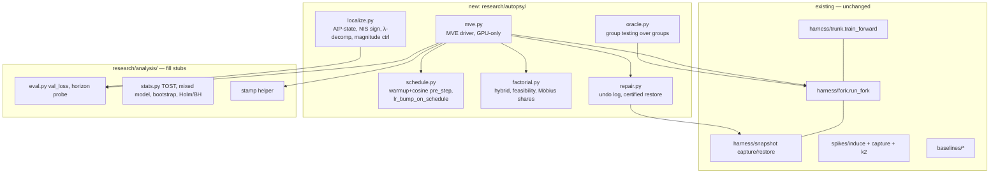

# Phase 6 · Implementation blueprint (2026-10-22)

**Research only.** Nothing here has been run, linted or tested, and no repo file was changed. The code blocks
are starter sketches written against the repo's real interfaces, which I re-read today [V]:
- `run_fork(cfg, data_dir, snapshot, intervention, steps, start_step, device, on_step, grad_hook, pre_step,
  seed, pre_opt_step)`, fork.py:29-83
- `train_forward` hook semantics, trunk.py:47-142
- the snapshot dict `{w, m, v, step, adam_step, rng_state, meta}`, keyed by parameter name, snapshot.py:33-102
- `get_batch(split, step, batch, block, data_dir, device)`, a pure function of the step, prepare.py:137
- `induce(kind, cfg, inject_step, width, **params)`, induce.py:169
- `compose(*pre_steps)`, fork.py:168

They go into the repo through a PR once the AMD GPU is available. **The harness (`determinism.py`,
`preflight.py`, `fork.py`) is not modified.** The one ROCm block for `determinism.py` (improvement A6) is
flagged for sign-off.

---

## 1 · Architecture



**Hook mapping:**

| Hook | Used for |
|---|---|
| `pre_step` | schedule, spike, fixes |
| `pre_opt_step` | gradient recording for the undo log; skip-step baselines |
| `intervention` or a snapshot dict edit before `run_fork` | hybrids, repairs (state edits at fork start) |
| `on_step` | horizon val probes, snapshot capture at t1 |

---

## 2 · Requirements

| Item | Version / choice | Note |
|---|---|---|
| GPU | 1× AMD MI300X (gfx942), 192 GB | Record the partition mode (SPX, 304 CUs) in every run's metadata |
| ROCm stack | one pinned image or wheel set; ROCm version TBD on day 1 | `rocm/pytorch-training` is being deprecated in favour of `rocm/primus` [V: Verifier]. Choose on day 1, then freeze |
| torch | **decision needed:** keep 2.10.0 (current pin; forks then need math SDPA) **or** move the AMD pin to ≥ 2.13 (AOTriton 0.12b deterministic attention backward) | Either way, update `research/requirements.txt` deliberately (not via Dependabot) and re-run the gate |
| Python deps | none new. numpy, scipy, safetensors, pyyaml and wandb are already pinned | stats via scipy/numpy; mixed model via statsmodels in `requirements-dev.txt` (analysis only) |
| Determinism env (proposed, flagged) | `CUBLAS_WORKSPACE_CONFIG` as now; `ROCBLAS_DEFAULT_ATOMICS_MODE=0`; `ROCBLAS_USE_HIPBLASLT=0`; `torch.backends.cuda.preferred_blas_library("cublas")`; fixed `HIPBLASLT_WORKSPACE_SIZE`; TunableOp off; `TORCH_COMPILE_DISABLE=1`; `TENSILE_SOLUTION_SELECTION_METHOD=0`; TF32 off | Needs sign-off before touching `determinism.py` (CLAUDE.md §1). The values come from the ROCm research pass ◐ |

## 3 · Repo layout (new files only)
```
research/autopsy/__init__.py
research/autopsy/schedule.py      # warmup+cosine pre_step; lr_bump that multiplies the schedule
research/autopsy/factorial.py     # hybrid(), violation_rate(), shares()
research/autopsy/oracle.py        # group_test() over group masks
research/autopsy/localize.py      # atp_state(), nis_sign(), lambda_decomp(), magnitude_ctrl() -> Localization dict
research/autopsy/repair.py        # record_grads(), undo(), certified_restore()
research/autopsy/mve.py           # GPU-only driver: python -m research.autopsy.mve --kind corrupt_batch --seed 1
research/analysis/eval.py         # val_loss(), horizon_probe()   (fills the TODO stub)
research/analysis/stats.py        # tost(), paired_bootstrap(), holm(), bh()   (fills the TODO stub)
research/experiments/autopsy/proxy_realistic.yaml   # warmup+cosine, >=20 tok/non-emb param
research/experiments/autopsy/mid_rung.yaml          # 6L/384
research/tests/test_autopsy.py    # CPU tests of the pure helpers (run in GitHub CI only)
```
**Config system:** the existing YAML + `load_config(path, overrides)` dotted overrides [V].

**Tracking:** every output JSON is stamped (git SHA, cfg, argv, torch/HIP/AOTriton versions, device,
partition mode). W&B is optional (pinned 0.26.1); JSON is the source of truth.

## 4 · Starter code (sketches, not run)

### 4.1 Schedule, and the `lr_bump` fix (gap 16)
```python
import math


def warmup_cosine(base_lr: float, warmup: int, total: int, min_ratio: float = 0.1):
    """Return (pre_step, lr_at). pre_step sets every group's LR each step, so trunk and forks share it."""

    def lr_at(step: int) -> float:
        if step < warmup:
            return base_lr * (step + 1) / warmup
        p = min(1.0, (step - warmup) / max(1, total - warmup))
        return base_lr * (min_ratio + (1 - min_ratio) * 0.5 * (1 + math.cos(math.pi * p)))

    def pre_step(step, ctx):
        for g in ctx["opt"].param_groups:
            g["lr"] = lr_at(step)

    return pre_step, lr_at


def lr_bump_on_schedule(lr_at, inject_step: int, width: int, factor: float = 10.0):
    """lr_bump that MULTIPLIES the scheduled LR. induce._lr_bump sets an absolute base*factor and would
    silently undo any schedule. Compose AFTER the schedule: compose(sched, bump)."""

    def pre_step(step, ctx):
        if inject_step <= step < inject_step + width:
            for g in ctx["opt"].param_groups:
                g["lr"] = lr_at(step) * factor

    return pre_step
```

### 4.2 Hybrids, the feasibility bound, and the state shares
```python
import math


def hybrid(b0: dict, bs: dict, *, w: str, m: str, v: str) -> dict:
    """Cross-world state at the same cut t1. Each channel comes from '0' (B0, damaged) or '*' (B*, clean)."""
    assert b0["step"] == bs["step"] and b0["adam_step"] == bs["adam_step"], "cut both branches at the same t1"
    src = {"0": b0, "*": bs}
    return {
        "w": src[w]["w"],
        "m": src[m]["m"],
        "v": src[v]["v"],
        "step": b0["step"],
        "adam_step": b0["adam_step"],
        "rng_state": b0["rng_state"],  # dropout=0: neither branch consumed RNG; assert equal in the driver
        "meta": {"hybrid": w + m + v},
    }


def adam_bound(b1: float, b2: float) -> float:
    """|m| <= C*sqrt(v) for every honest Adam state (Cauchy-Schwarz on both EMAs); 1.165 at (0.9, 0.95)."""
    return (1 - b1) / math.sqrt(1 - b2) / math.sqrt(1 - b1 * b1 / b2)


def violation_rate(snap: dict, b1: float, b2: float, rtol: float = 1e-4) -> float:
    c = adam_bound(b1, b2)
    bad = tot = 0
    for n, m in snap["m"].items():
        bad += int((m.abs() > c * snap["v"][n].sqrt() * (1 + rtol) + 1e-30).sum())
        tot += m.numel()
    return bad / tot


def shares(d: dict) -> dict:
    """d[cell] = Δ vs B*, cell = w,m,v digits with 1 = damaged; d['000'] == 0. 09_analysis §4."""
    tot = d["111"]
    phi = 0.5 * (d["011"] + tot - d["100"])  # 2-player Shapley share of {state} vs {weights}
    return {"shapley_state": phi / tot, "noising": d["011"] / tot, "denoising": 1 - d["100"] / tot}
```
(The driver maps the cell string 'abc' to `hybrid(..., w='0' if a=='1' else '*', ...)`.)

### 4.3 The undo log (exact; record gradients in the experiment)
```python
def record_grads(window: range, store: dict):
    """pre_opt_step hook: fires after the global clip, right before opt.step(), so p.grad is the
    POST-CLIP gradient Adam consumes. Stores CPU fp32 copies for steps in `window`."""

    def pre_opt_step(step, ctx):
        if step in window:
            store[step] = {
                n: p.grad.detach().float().cpu().clone()
                for n, p in ctx["model"].named_parameters()
                if p.grad is not None
            }

    return pre_opt_step


def undo(snap: dict, grads: dict, vbar: dict, b1: float, b2: float, channels=("m", "v")) -> dict:
    """Remove the window's direct contribution to m and v; w is untouched. snap['step'] is the next step to run,
    so the last executed step is snap['step'] - 1. The removed g^2 is replaced by v̄ (09_analysis §3)."""
    last = snap["step"] - 1
    out = {**snap, "m": dict(snap["m"]), "v": dict(snap["v"]), "meta": {**snap["meta"], "undo": list(channels)}}
    for s, g in grads.items():
        k = last - s
        for n, gs in g.items():
            if "m" in channels:
                out["m"][n] = out["m"][n] - (1 - b1) * b1**k * gs
            if "v" in channels:
                out["v"][n] = (out["v"][n] - (1 - b2) * b2**k * (gs * gs - vbar[n])).clamp_min(0)
    return out
```

### 4.4 Held-out evaluation (gap 2, gap 15) and placebo replicates
```python
def val_loss(model, cfg: dict, data_dir: str, start: int = 1000, n: int = 64, batch: int = 64) -> float:
    """Mean loss on a FIXED held-out set: val batches [start, start+n), disjoint from the localizer probe
    (k2.PROBE = val 0-3). n=64 x 64 x 256 ≈ 1.05M tokens. No RNG consumed (dropout=0)."""
    import torch

    from research.data.prepare import get_batch

    dev = next(model.parameters()).device
    block = cfg["model"]["block_size"]
    with torch.no_grad():
        return sum(float(model(*get_batch("val", start + k, batch, block, data_dir, dev))[1]) for k in range(n)) / n


def horizon_probe(t_start: int, horizons: set, cfg: dict, data_dir: str, out: dict):
    def on_step(step, info):
        done = step - t_start + 1
        if done in horizons:
            out[done] = val_loss(info["model"], cfg, data_dir)

    return on_step


def nudge(snap: dict, k: int) -> dict:
    """k-th placebo replicate: relative ~k-ulp perturbation of all weights (k=0 is the unperturbed run)."""
    eps = k * 2.0**-23
    return {**snap, "w": {n: t * (1 + eps) for n, t in snap["w"].items()}}
```
**Wrap-around check (found while trying to break this sketch).** `get_batch` reads offset
(step·batch·block) mod (len(val) − block − 1) [V: prepare.py:137-160]. If the `val` shard holds fewer than
about 16.4M + 1.05M tokens, the eval batches at 1000+ wrap onto the probe region (val 0–3), and the leakage
that gap 15 removes comes back. Before locking `start`, compute both token intervals modulo the span on the
real shard and assert they are disjoint. If the shard is small, pick `start` so the intervals don't overlap.

**Gate G0 must include `horizon_probe`.** A noop-vs-noop pair run *with* the probes must still match bitwise,
because the eval forward passes run inside the training loop [I].

### 4.5 MVE driver outline (GPU-only; one process seeds once)
```python
def run_instance(kind: str, seed: int, out_path: str):
    import json

    import torch

    from research.configs import load_config
    from research.harness.fork import compose, run_fork
    from research.harness.snapshot import capture
    from research.harness.trunk import run_trunk
    from research.spikes.induce import induce

    if not torch.cuda.is_available():  # on ROCm this is True for the MI300X ("cuda" is PyTorch's name for HIP)
        raise SystemExit("GPU required — run on the AMD MI300X, never on the laptop.")
    cfg = load_config("research/experiments/autopsy/proxy_realistic.yaml", {"seed": seed})
    sched, lr_at = warmup_cosine(cfg["optim"]["lr"], cfg["train"]["warmup"], cfg["train"]["max_steps"])
    fork_step, s0, width = 160, 160, 5
    cuts = (1, 10, 60)  # t1 = s1 + c
    spike = (lr_bump_on_schedule(lr_at, s0, width) if kind == "lr_bump"
             else induce(kind, cfg, inject_step=s0, width=width).pre_step)

    snaps = {}
    run_trunk(cfg, DATA, steps=fork_step, pre_step=sched, deterministic=True,  # the only seeding call
              on_step=lambda s, i: snaps.__setitem__("fork", capture(i["model"], i["opt"], s + 1)) if s + 1 == fork_step else None)
    # B0 and B* to each cut; record post-clip grads in the spike window for the undo log
    # ... run_fork(cfg, DATA, snaps["fork"], steps=t1 - fork_step, pre_step=compose(sched, spike), seed=False,
    #              pre_opt_step=record_grads(range(s0, s0 + width), grads), on_step=<capture at t1>)
    # ... 8 hybrid cells + 3 undo arms + 5 placebo pairs, each run_fork(..., pre_step=sched, seed=False,
    #     on_step=horizon_probe(t1, {50, 150, 300}, cfg, DATA, res))
    # ... json.dump({"stamp": stamp(cfg), "D": ..., "shares": ..., "violations": ..., "undo": ..., "placebo": ...}, ...)
```

## 5 · Pipeline changes (training, evaluation, verification)
1. **Training:**
   - The schedule is a `pre_step` shared by the trunk and every fork. The spike composes after it, and
     fixes compose after the spike (the existing `compose` order rule [V]).
   - Realistic and mid-rung configs.
   - QK-Norm model variant: a model-file change, flagged.
2. **Evaluation:**
   - `val_loss` at horizons {50, 150, 300/500, end}, on a fixed disjoint set.
   - Stamps on everything.
   - `results/` README mapping each JSON to the command that made it.
3. **Verification:**
   - G0 cross-process gate through spike windows, with probes on.
   - Hybrid violation rate.
   - Placebo spread.
   - Oracle stability (Jaccard).
   - CPU unit tests for the pure helpers in GitHub CI only (`hybrid`, `adam_bound`, `shares`, `undo` on toy
     tensors where the closed form is known). Never run on the laptop.

## 6 · Week-by-week timeline to ICML 2027
The deadline is assumed to be about Jan 22–28 2027; re-check when the CFP is published.

| Week | Dates | Milestones | Gate |
|---|---|---|---|
| 1 | Oct 26 – Nov 1 | AMD SSH, ROCm pin, preflight, `step_timer`; G0 cross-process determinism through a spike window (with probes); PR the spike work; close Dependabot; commit the §4.7 thresholds; add `val_loss`, schedule, lr_bump fix, `Bs` clip fix, stamps; ask Avneh for follow-on hours with the timings; assign C2/C3/analysis owners | **G0** |
| 2 | Nov 2 – 8 | **MVE**: damage migration + undo + transplant + placebo + feasibility (12 instances, about 1–2 GPU-h); pilot SD → n | **G1, G2, G3** |
| 3 | Nov 9 – 15 | Realistic proxy + mid-rung trunks; QK-Norm variant; natural stress re-search; β2-instrument trunks (E1) | — |
| 4 | Nov 16 – 22 | Group-testing oracle; decoy benchmark; HVP math-backend check; AtP-state; NIS sign | — |
| 5 | Nov 23 – 29 | Localization scoring; λ-decomposition variant; β2 migration-law fits | **G4** |
| 6 | Nov 30 – Dec 6 | Repairs (undo variants, certified restore) + strong baselines; proxy battery | — |
| 7 | Dec 7 – 13 | Full battery proxy + mid rung; detector side product on telemetry | **G5** |
| 8 | Dec 14 – 20 | 124M trunks + primary contrast n ≥ 3 (n = 5 if hours allow); Muon control; untied ablation | **G6** |
| 9 | Dec 21 – 27 | Stats and figures; SpikeState packaging; optional 350M instance | — |
| 10 | Dec 28 – Jan 3 | Draft 1; related-work table; reviewer simulation round 2 | — |
| 11 | Jan 4 – 10 | Gap-filling experiments and ablations; appendix | — |
| 12 | Jan 11 – 17 | Internal review; reproducibility pass; anonymized code zip | — |
| 13 | Jan 18 – 24 | Abstract and paper submission (confirm dates); arXiv per ICML policy | submit |

**Owners:** spike engineer (jaztulsi) on schedule, spikes and MVE; Eddie on baselines; the C2/C3 and analysis
owners still need assigning (improvement C6). One person can't carry weeks 4–8 alone.
